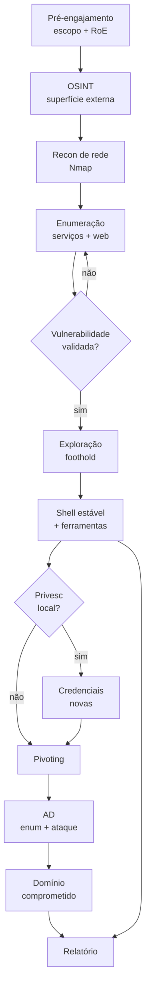

# ⚔️ A Bíblia do Engage

> [!info] O que é esta pasta
> Material de estudo e **checklist de engajamento** ponta a ponta: pré-engajamento → OSINT → recon → enumeração → exploração → shell → pivoting → AD → privesc → relatório.
> As notas foram escritas para consulta **offline**, com os comandos que realmente se usam e o motivo de cada um.
> Base: path **CPTS (Penetration Tester)** da HTB Academy — 28 módulos — mais prática de lab.

---

## 🚀 Por onde começar

| Ordem | Nota | Para quê |
|-------|------|----------|
| 1 | [[Workflow do Engage]] | **Leia primeiro.** Visão ampla do engajamento inteiro, fase por fase, com links para o detalhe. |
| 2 | [[Fase 01 - Pré-Engajamento]] | Contrato, escopo, RoE, tipos de teste. |
| 3 | [[Fase 02 - OSINT e Reconhecimento Externo]] | Superfície pública: DNS, subdomínios, vazamentos, tecnologia. |
| 4 | [[Fase 03 - Reconhecimento de Rede]] | Nmap e descoberta de hosts/portas. |
| 5 | [[Fase 04 - Enumeração de Serviços]] | Tirar o máximo de cada porta aberta. |
| 6 | [[Fase 05 - Enumeração Web]] | Burp, ffuf, vhosts, conteúdo, parâmetros. |
| 7 | [[Fase 06 - Vulnerabilidade e Exploração]] | Validar falha, escolher exploit, ganhar acesso. |
| 8 | [[Fase 07 - Shells e Transferência de Arquivos]] | Payload, shell estável, mover ferramentas. |
| 9 | [[Fase 08 - Pivoting e Tunneling]] | Alcançar redes internas. |
| 10 | [[Fase 09 - Active Directory]] | Enumeração credenciada → comprometer o domínio. |
| 11 | [[Fase 10 - Privilege Escalation]] | Linux e Windows até root/SYSTEM. |
| 12 | [[Fase 11 - Pós-Exploração]] | Credenciais, movimento lateral, limpeza. |
| 13 | [[Fase 12 - Relatório e Encerramento]] | Documentar, classificar risco, entregar. |

---

## 🗺️ Mapa do engajamento

> O fluxo **não é linear**. Cada nova credencial reabre enumeração; cada host novo reabre pivoting. O relatório é escrito **durante** o engage, não no fim.

---

## 📚 Cheatsheets CPTS (28 módulos)

Pasta: `Cheatsheets CPTS/`. Cada nota é um cartão de comandos no estilo dos PDFs oficiais, com explicação.

| # | Módulo | Nível |
|---|--------|-------|
| 01 | [[CPTS 01 - Penetration Testing Process]] | Fundamental |
| 02 | [[CPTS 02 - Getting Started]] | Fundamental |
| 03 | [[CPTS 03 - Network Enumeration with Nmap]] | Easy |
| 04 | [[CPTS 04 - Footprinting]] | Medium |
| 05 | [[CPTS 05 - Information Gathering - Web Edition]] | Easy |
| 06 | [[CPTS 06 - Vulnerability Assessment]] | Easy |
| 07 | [[CPTS 07 - File Transfers]] | Medium |
| 08 | [[CPTS 08 - Shells and Payloads]] | Medium |
| 09 | [[CPTS 09 - Using the Metasploit Framework]] | Easy |
| 10 | [[CPTS 10 - Password Attacks]] | Medium |
| 11 | [[CPTS 11 - Attacking Common Services]] | Medium |
| 12 | [[CPTS 12 - Pivoting, Tunneling, and Port Forwarding]] | Medium |
| 13 | [[CPTS 13 - Active Directory Enumeration and Attacks]] | Medium |
| 14 | [[CPTS 14 - Using Web Proxies]] | Easy |
| 15 | [[CPTS 15 - Attacking Web Applications with Ffuf]] | Easy |
| 16 | [[CPTS 16 - Login Brute Forcing]] | Easy |
| 17 | [[CPTS 17 - SQL Injection Fundamentals]] | Medium |
| 18 | [[CPTS 18 - SQLMap Essentials]] | Easy |
| 19 | [[CPTS 19 - Cross-Site Scripting XSS]] | Easy |
| 20 | [[CPTS 20 - File Inclusion]] | Medium |
| 21 | [[CPTS 21 - File Upload Attacks]] | Medium |
| 22 | [[CPTS 22 - Command Injections]] | Medium |
| 23 | [[CPTS 23 - Web Attacks]] | Medium |
| 24 | [[CPTS 24 - Attacking Common Applications]] | Medium |
| 25 | [[CPTS 25 - Linux Privilege Escalation]] | Easy |
| 26 | [[CPTS 26 - Windows Privilege Escalation]] | Medium |
| 27 | [[CPTS 27 - Documentation and Reporting]] | Easy |
| 28 | [[CPTS 28 - Attacking Enterprise Networks]] | Medium |

> [!note] Sobre os PDFs oficiais
> A HTB entrega um PDF por módulo dentro da plataforma autenticada. **Três** estão baixados nesta máquina e foram usados como fonte:
> - `/home/sime/Downloads/Network Enumeration with Nmap - cheatsheet.pdf`
> - `/home/sime/Downloads/Active Directory Enumeration & Attacks - cheatsheet.pdf`
> - `/home/sime/Projetos/kali-setup/htb/vault-obsidian/Password Attacks - cheatsheet.pdf`
>
> Os outros 25 cartões foram escritos a partir do conteúdo equivalente de cada módulo, em Markdown, para consulta offline. Se você baixar o PDF oficial de um módulo, dá para comparar linha a linha com o cartão correspondente.

---

## 🎓 Roteiro de estudo (CPTS)

1. **Fundamentos:** Process, Getting Started, Nmap, Footprinting.
2. **Web:** Information Gathering, Web Proxies, Ffuf, Login Brute, SQLi, SQLMap, XSS, File Inclusion, File Upload, Command Injection, Web Attacks, Common Applications.
3. **Infra:** Password Attacks, Common Services, File Transfers, Shells, Metasploit, Pivoting.
4. **Enterprise:** AD Enumeration & Attacks, Linux PrivEsc, Windows PrivEsc.
5. **Fechamento:** Documentation & Reporting, Attacking Enterprise Networks.
6. **Prova:** os 3 skills assessments + exame. Use [[Fase 12 - Relatório e Encerramento]] como checklist.

---

## 🏷️ Convenções usadas nas notas

| Símbolo | Significado |
|---------|-------------|
| 🐧 | Executado do atacante Linux |
| 🪟 | Executado em host Windows |
| 🔵 | Ferramenta externa (instalar/baixar) |
| 🟢 | Living off the Land (nativo do SO) |
| ⚠️ | Requer credencial / contexto específico |
| 🌐 | Requer conectividade com o alvo |
| 🎫 | Requer ticket/hash/senha |
| 💡 | Dica de decisão |
| 🕳️ | Pegadinha comum |

---

## ✅ Checklist mestre do engage

- [ ] Escopo, janela e contatos confirmados por escrito
- [ ] RoE assinado (o que é permitido, o que para o teste)
- [ ] Rede de ataque pronta (VPN, ferramentas, wordlists)
- [ ] Recon externo documentado (DNS, subdomínios, tecnologias, vazamentos)
- [ ] Nmap completo salvo em `-oA`
- [ ] Cada serviço enumerado e anotado com evidência
- [ ] Vulnerabilidades validadas (não só scanner)
- [ ] Foothold + shell estável
- [ ] Privesc local
- [ ] Pivoting para rede interna
- [ ] AD mapeado (BloodHound) e caminho escolhido
- [ ] Domain Admin / objetivo do escopo atingido
- [ ] Evidências e timestamps coletados
- [ ] Relatório revisado e entregue
