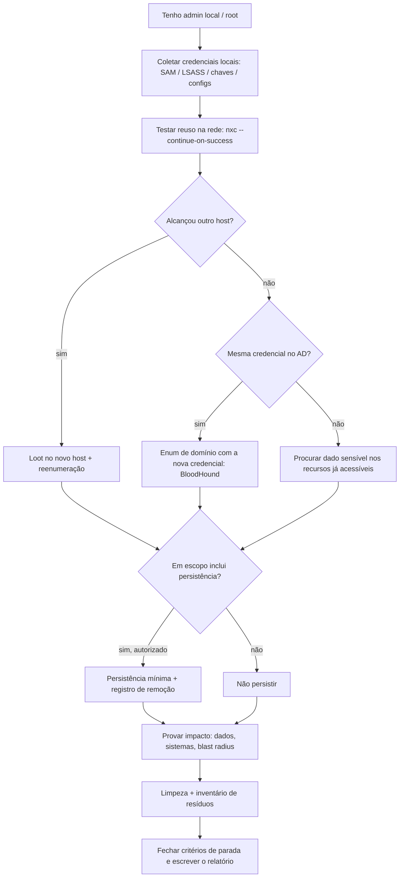

# 🎒 Fase 11 — Pós-Exploração

> [!info] Objetivo da fase
> Transformar acesso técnico em **prova de impacto de negócio**. Você já tem host(s) e credencial(is); agora responde: *até onde dá para ir, o que está exposto e o que isso significa para o cliente?*
> Pós-exploração = **coletar loot → reaproveitar credencial → entender o que está em jogo → documentar**. Persistência só existe se o RoE autorizar.

---

## 🎯 Quando entrar

| Sinal | Por quê |
|-------|---------|
| Root/SYSTEM/admin local obtido | É o ponto de coleta máxima no host |
| Credencial nova capturada (hash, senha, ticket, chave) | Reabre enumeração em toda a rede |
| Domínio comprometido | Pós-exploração define o *blast radius* real |
| Objetivo do escopo é "dados sensíveis" ou "sistemas críticos" | Só a pós-exploração prova |
| Escopo inclui persistência/simulação de APT | Aqui é onde ela entra |

**Esta fase não é linear.** Ela acontece em paralelo com [[Fase 08 - Pivoting e Tunneling]], [[Fase 09 - Active Directory]] e [[Fase 10 - Privilege Escalation]] — cada nova credencial reinicia o ciclo.

---

## 📥 Pré-requisitos

| Pré-requisito | Detalhe |
|---------------|---------|
| Shell estável em pelo menos um host | Sem TTY, coleta de loot é sofrível |
| Canal de saída de dados | HTTP, SMB, DNS, `scp`; tenha um destino organizado |
| Autorização de coleta | O RoE define o que pode ser lido/extraído (PII! bancos! e-mail!) |
| Método de armazenamento seguro | Pasta de loot criptografada, sem expor dados no chat/printf |
| Registro de credenciais | Tabela única com origem, tipo, validade e escopo |

> [!danger] Dados do cliente são responsabilidade sua
> Não copie bases inteiras "por via das dúvidas". Colete o **mínimo necessário para provar o impacto** (ex.: 5 registros, contagem total) e combine a destruição ou devolução no encerramento. Vazamento pós-engajamento é incidente.

---

## 🪜 Passo a passo

### 1. Taxonomia do loot — o que vale a pena procurar

| Categoria | Itens | Onde procurar |
|-----------|-------|---------------|
| **Credenciais** | Senhas em claro, hashes NT, tickets, chaves SSH, certificados, `.kdbx`, `id_rsa` | Configs, histórico, shares, LSASS, SAM, NTDS, papéis de parede, notas |
| **Infraestrutura** | Diagramas, inventário, playbooks Ansible, configs de VPN, backup jobs | Shares de TI, home de admins, `/opt`, `C:\Scripts` |
| **Aplicações** | Connection strings, tokens de API, `.env`, `web.config`, CI/CD secrets | Web roots, Jenkins, GitLab, pipelines |
| **Nuvem** | Chaves AWS/Azure/GCP, tokens de IMDS, credenciais em scripts | `~/.aws/credentials`, IMDS `169.254.169.254`, variáveis de ambiente |
| **Dados de negócio** | PII, financeiro, contratos, código-fonte, e-mail, backups | Shares, bancos, SharePoint, file servers |
| **Configuração de segurança** | GPOs, políticas, exceções, contas de serviço, trusts | `SYSVOL`, AD, consoles de gestão |

```bash
# SMB: varrer shares atrás de palavras-chave (sem baixar tudo)
nxc smb <CIDR> -u <USUARIO> -p <SENHA> --shares
nxc smb <IP> -u <USUARIO> -p <SENHA> -M spider_plus -o EXCLUDE_DIR=IPC$,print$
# Busca por nome de arquivo sensível
nxc smb <IP> -u <USUARIO> -p <SENHA> --spider 'Arquivos' --pattern 'password|senha|creds|*.kdbx|id_rsa'
# Ferramenta dedicada: manspider (conteúdo, não só nome)
manspider <CIDR> -u <USUARIO> -p <SENHA> -f passw user admin secret -e xlsx docx pdf config xml kdbx
```

```bash
# Linux: arquivos de segredo, chaves e histórico
grep -rinaE 'passw|senha|secret|token|api[_-]?key' /var/www /opt /home /etc 2>/dev/null
find / -name 'id_rsa' -o -name '*.kdbx' -o -name '.env' -o -name '*.key' 2>/dev/null
```

```powershell
# Windows: mesmo raciocínio
findstr /s /i /m "password senha conexao" C:\*.config C:\*.xml C:\*.ini C:\*.txt
dir /s /b C:\Users\*pass* C:\Users\*cred* C:\Users\*.kdbx 2>nul
```

> [!tip] Papel de parede, OneNote e área de trabalho entregam senha
> Procure `*.txt` na Desktop, `*.rdp` (hostnames internos), planilhas com "senhas" no nome, e desbloqueie KeePass com wordlist se o cliente autorizar.

### 2. Gestão de credenciais — disciplina que evita retrabalho

Sem uma tabela, você vai testar a mesma senha três vezes e bloquear a conta.

| Campo | Exemplo |
|-------|---------|
| Credencial | `svc_backup` |
| Tipo | senha em claro / NT hash / ccache / chave SSH / certificado |
| Origem | `host01` → `/opt/backup/.env` (ou `nxc smb --loggedon-users`) |
| Validade | válida / expirada / desconhecida |
| Testada em | `10.10.10.0/24` (SMB), DC (LDAP) |
| Privilégio | usuário comum · admin local em `host07` · Domain Admin |
| Escopo | dentro do escopo? sim/não |

Regras práticas:

1. **Valide uma vez, na rede inteira de uma só vez** — `nxc smb <CIDR> -u u -p p --continue-on-success` mostra onde ela é admin local (`(Pwn3d!)`).
2. **Anote antes de usar.** Credencial usada e não registrada é credencial perdida.
3. **Nunca teste credencial fora do escopo** — lockout em sistema de cliente errado é incidente.
4. **Hashes não são universais:** alguns serviços só aceitam Kerberos, outros só NTLM. Se o hash falhar, tente overpass-the-hash → TGT.
5. **Tickets expiram:** ccache tem TTL; registre a hora da captura e renove via `getTGT.py`.
6. **Nunca** reuse credencial fora da janela autorizada ou em horário proibido pelo RoE.

```bash
# Mapear onde a credencial é admin local (uma passada, sem repetir por host)
nxc smb <CIDR> -u <USUARIO> -p <SENHA> --continue-on-success

# Procurar outras credenciais em hosts onde EU sou admin
nxc smb <CIDR> -u <USUARIO> -p <SENHA> -M lsassy      # LSASS remote dump
nxc smb <CIDR> -u <USUARIO> -p <SENHA> -M sam           # SAM/LSA remoto
```

### 3. Movimento lateral por reuso

O caminho mais comum em rede corporativa: a **mesma senha/hash de admin local** em muitos hosts, ou uma conta de serviço usada em vários servidores.

```bash
# Pass-the-hash
wmiexec.py -hashes :<NTHASH> <DOMINIO>/<USUARIO>@<IP_ALVO>
psexec.py  -hashes :<NTHASH> <DOMINIO>/<USUARIO>@<IP_ALVO>

# Kerberos (quando NTLM é bloqueado)
getTGT.py <DOMINIO>/<USUARIO> -hashes :<NTHASH> -dc-ip <IP_DC>
export KRB5CCNAME=<USUARIO>.ccache
nxc smb <IP_ALVO> -k -no-pass

# Sessões/logons ativos: onde vale a pena "morar" (admin logado = hash na memória)
nxc smb <CIDR> -u <USUARIO> -p <SENHA> --loggedon-users
```

| Padrão de reuso | Como detectar | Impacto |
|-----------------|---------------|---------|
| Hash de admin local igual em vários hosts | `nxc smb` → `(Pwn3d!)` em massa | Comprometimento de frota inteira |
| Conta de serviço compartilhada | SPN igual em muitos hosts | Kerberoast rende vários hosts |
| Chave SSH `authorized_keys` replicada | `cat ~/.ssh/authorized_keys` | Acesso persistente a muitos servidores |
| Conta de domínio com logon em servidores | `--loggedon-users`, BloodHound | DACL/caminho no AD |

### 4. Trusts e caminhos entre domínios

```powershell
Get-DomainTrustMapping          # PowerView: mapa de trusts
nltest /domain_trusts /all_trusts /v
```

Sem escalada dentro do domínio atual, o caminho pode ser em outro domínio da mesma floresta (parent/child) ou em outro forest. Regra: **SID filtering** e o tipo de trust decidem se o ataque (ExtraSids, inter-realm TGT) é viável — confirme antes de documentar como achado válido.

### 5. Dados sensíveis — o "e daí?" do relatório

Encontrar um arquivo interessante no share não vale nada se você não explicar o impacto. Para cada dado, colete:

- **O que é** (ex.: folha de pagamento, dump de produção, chave privada de VPN).
- **Quantidade** (agregado, ex.: "≈12.000 registros com nome, CPF e salário").
- **Amostra mínima** (3–5 linhas mascaradas como evidência).
- **Quem acessa hoje** (grupos com permissão no recurso).
- **Impacto** (LGPD/regulador, fraude, espionagem industrial, parada de produção).

```bash
# Banco acessível: pare no SELECT count(*) e em uma amostra
nxc mssql <IP> -u <USUARIO> -p <SENHA> -q "SELECT TOP 5 name FROM sys.databases"
# Documente: tipo de dado, volume, sensibilidade — NÃO extraia a base
```

> [!warning] LGPD/GDPR no meio: contenção
> Achou PII, cartão, dado de saúde? Documente o **mínimo**, comunique o contato do cliente conforme o RoE e não saia copiando bases. Isso pode alterar o escopo do teste.

### 6. Persistência — só com autorização explícita

> [!danger] Persistência é a decisão mais política do engajamento
> Sem cláusula explícita no RoE, **não** crie persistência. Backdoor esquecido vira incidente real e mata a relação com o cliente.

Se autorizado, escolha o mecanismo mais simples que atende ao objetivo e **registre como remover**:

| Mecanismo | Ponto de apoio | Remoção |
|-----------|----------------|---------|
| Golden ticket | Hash do `krbtgt` | Trocar a senha do krbtgt **duas vezes** |
| Direito de DCSync | ACL no domínio | Remover a ACE no objeto do domínio |
| Conta nova com privilégio | AD | Desabilitar e deletar |
| Chave SSH em `authorized_keys` | Linux | Remover a linha |
| Tarefa agendada / cron | Host | `schtasks /delete` · remover a linha do crontab |
| Serviço criado | Windows | `sc delete` |
| WMI event subscription | Windows | Remover `__EventFilter`/`CommandLineEventConsumer` |
| GPO maliciosa | AD | Remover a GPO e a linkagem |

**Regra:** toda persistência tem ID, host, técnica, data de criação, prazo de validade e passo de remoção na sua nota de engajamento.

### 7. Limpeza — tão importante quanto o ataque

```bash
# Linux: remover ferramentas e artefatos criados por você
rm -f /tmp/linpeas.sh /tmp/pspy /tmp/rootbash /tmp/pe.so
# Windows:
# del C:\Windows\Temp\winpeas.exe C:\Windows\Temp\evil.msi
# reg delete HKCU\Software\Classes\ms-settings /f
# sc delete <SERVICO_CRIADO>
```

Checklist de limpeza:

- [ ] Binários e scripts que você subiu (host por host)
- [ ] Webshells, JSP/ASPX, arquivos em webroot
- [ ] Contas e grupos que você criou (AD, local, banco)
- [ ] Persistência (tickets, ACLs, tarefas, serviços, chaves, GPOs)
- [ ] Modificações de configuração (registro, `sshd_config`, `exports`, ADCS)
- [ ] Artefatos de enumeração (`.zip` do SharpHound, logs, `.ccache` copiado)
- [ ] Registro do que **não** foi possível remover, com motivo e risco

### 8. Critérios de parada

Pare quando **qualquer** condição for verdadeira:

| Critério | Exemplo |
|----------|---------|
| Objetivo do escopo cumprido | Domain Admin provado, dado crítico acessado |
| Impacto já demonstrado | A partir daqui é só "colecionar" — sem valor novo |
| Risco desproporcional | A próxima ação pode derrubar produção |
| Retornos decrescentes | Duas horas sem novo achado relevante |
| Sinal de detecção/incidente | Blue team reagiu, contato pediu pausa |

> [!tip] Colecionar admin não é entregar valor
> Seis Domain Admins provam a mesma coisa que um. Use a próxima hora para **documentar a cadeia** e fechar o relatório.

---

## 🧰 Ferramentas

| Ferramenta | O que faz |
|-----------|-----------|
| `nxc` (`smb`/`ldap`/`mssql`) com `-M lsassy/sam/spider_plus` | Varredura em frota e coleta remota |
| `manspider` | Busca por **conteúdo** em shares (regex) |
| `secretsdump.py` | Dump de SAM/LSA/NTDS remoto |
| `getTGT.py` / `getST` | Converter hash em ticket |
| `mimikatz` / `pypykatz` | Credenciais em memória (LSASS) |
| `BloodHound` | Reavaliar caminhos depois de cada credencial nova |
| `trufflehog` / `gitleaks` | Segredos em repositórios |
| `keepass2john` / `hashcat` | Abrir cofres KeePass autorizados |
| `Evidencias/notas` (Obsidian, CherryTree) | Registro com timestamp |

---

## 🔀 Árvore de decisão



---

## 📤 Evidências

| Evidência | Formato ideal |
|-----------|---------------|
| Reuso comprovado | Tabela: credencial × host × privilégio obtido |
| Validação de impacto | Print + contagem, dado mascarado |
| Cadeia pós-exploração | Diagrama do fluxo (host A → credencial → host B → dado) |
| Persistência (se houver) | Técnica, hora de criação, hora de remoção, hash do artefato removido |
| Resíduos | Lista do que ficou, com justificativa |
| Linha do tempo | Início/fim por ação, fuso horário explícito |

> [!info] Toda evidência precisa de contexto
> Screenshot sem host, hora e comando é inútil. O padrão: **host → comando → saída → interpretação**.

---

## 🕳️ Pegadinhas

| Pegadinha | Realidade |
|-----------|-----------|
| Copiar a base de dados inteira "para provar" | Excesso de coleta = risco legal e de vazamento |
| Criar persistência "para garantir" | Sem autorização, é backdoor — incidente |
| Reusar credencial em horário proibido | Viola o RoE, mesmo dentro do escopo |
| Testar credencial sem registrar | Retrabalho garantido e risco de lockout |
| Não limpar SUID/contas/serviços | Deixa vulnerabilidade nova no cliente |
| Achar PII e não comunicar | Falha de obrigação contratual/regulatória |
| Continuar depois do objetivo | Aumenta risco e não muda o relatório |
| Ignorar fusos horários | Correlação de logs quebra e a linha do tempo perde valor |
| Documentar só o sucesso | Tentativas e bloqueios também explicam o risco |

---

## ✅ Checklist

- [ ] Loot catalogado por categoria (credenciais, infra, app, nuvem, dados, config)
- [ ] Tabela de credenciais atualizada (tipo, origem, validade, escopo)
- [ ] Reuso testado com uma passada única na rede (sem lockout)
- [ ] BloodHound reexecutado com cada credencial nova
- [ ] Trusts revisitados após ganho de privilégio
- [ ] Dados sensíveis localizados, quantificados e amostrados (mascarados)
- [ ] Impacto de negócio escrito para cada dado crítico
- [ ] Persistência: autorizada? criada? registrada? removível?
- [ ] Limpeza executada e resíduos inventariados
- [ ] Critérios de parada checados antes de continuar
- [ ] Linha do tempo e evidências organizadas para o relatório

---

## 🔗 Relacionado

- [[Fase 09 - Active Directory]]
- [[Fase 10 - Privilege Escalation]]
- [[Fase 08 - Pivoting e Tunneling]]
- [[Fase 12 - Relatório e Encerramento]]
- [[CPTS 28 - Attacking Enterprise Networks]]
