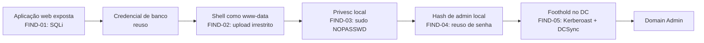
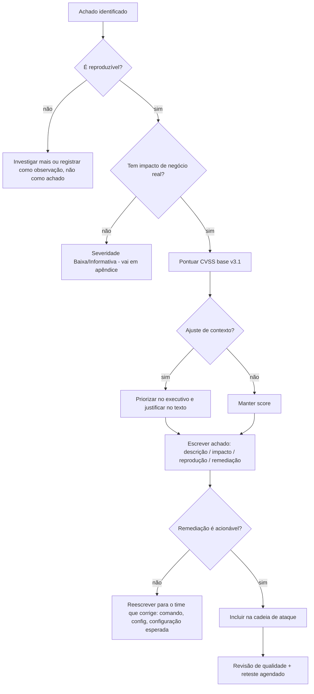

[[Workflow do Engage]]
# 📄 Fase 12 — Relatório e Encerramento

> [!info] Objetivo da fase
> Converter o engajamento em **decisão de negócio**: o cliente precisa entender o risco, priorizar a correção e conseguir reproduzir/validar cada achado.
> O relatório é **o produto**. Shell, DCSync e Domain Admin são meios. Um achado crítico mal escrito vira "achado técnico ignorado" no mês seguinte.

---

## 🎯 Quando entrar

| Momento | Ação |
|---------|------|
| **Durante** o engajamento | Escreva o achado no momento em que o encontra (evidência ainda fresca, comando ainda no histórico) |
| Fim da fase de exploração | Consolide achados, feche severidade e prepare a cadeia de ataque |
| Última hora de cada dia de teste | Revise a nota de engajamento: o que fiz, o que falhou, o que falta |
| Após a limpeza | Confirme que os resíduos estão registrados antes de escrever a conclusão |
| Pós-entrega | Reteste, debrief e fechamento |

**Nunca** deixe o relatório para depois do último dia. Reconstruir comando e saída de cabeça é onde nascem os erros.

---

## 📥 Pré-requisitos

| Pré-requisito | Detalhe |
|---------------|---------|
| Notas do engage organizadas | Por host, com timestamp e saída de comando — ver [[Workflow do Engage]] |
| Evidências capturadas | Prints com contexto, saídas em texto, arquivos de scan |
| Escopo e RoE à mão | Para escrever escopo, limitações e o que **não** foi testado |
| Contatos e entregáveis definidos | Formato (PDF/DOCX), prazo, quem lê, se haverá debrief |
| Template do cliente, se houver | Siga o template dele; se não houver, use o da casa |
| Classificação de confidencialidade | Marque o documento (ex.: "Confidencial — uso restrito") |

---

## 🪜 Passo a passo

### 1. Estrutura padrão do relatório

```text
1. Capa
   - título, cliente, tipo de teste, janela, versão, classificação
2. Sumário executivo            (1 página, linguagem de negócio)
3. Escopo e metodologia
   - alvos, o que ficou fora, abordagem, frameworks (PTES/OWASP/MITRE)
4. Sumário de achados           (tabela: ID, título, severidade, CVSS)
5. Achados detalhados           (um por seção — o coração do documento)
6. Cadeia de ataque             (como os achados se conectam)
7. Conclusão e próximos passos
8. Apêndices
   A. Ferramentas e comandos
   B. Linha do tempo
   C. Saídas brutas relevantes
   D. Glossário / referências
```

> [!tip] Regra do leitor duplo
> O executivo lê **só** o sumário executivo. O técnico do cliente vai direto ao **passo a passo de reprodução**. Escreva para os dois — em seções diferentes.

### 2. Sumário executivo

O que **precisa** estar aqui:

- O que foi testado e quando (uma frase).
- O resultado em linguagem de negócio: "foi possível assumir o controle do domínio a partir da rede de visitantes".
- Os 3–5 riscos mais relevantes, com impacto (financeiro, regulatório, operacional, reputacional).
- Blast radius: quais dados/sistemas ficaram expostos.
- O que está bem (controles que resistiram) — dá credibilidade.
- Prioridades de correção, em ordem.

O que **não** entra: vetor CVSS, nome de ferramenta, hash, payload, log bruto, jargão ("DCSync", "RBCD", "ESC1") sem explicação.

```text
EXEMPLO DE FRASE EXECUTIVA
"Entre 12 e 16 de maio, avaliamos a rede interna a partir de uma sessão
de VPN sem privilégios. Foi possível assumir o controle do domínio
(equivalente a acesso administrativo total) em menos de 4 horas,
utilizando uma senha fraca de conta de serviço e uma delegação mal
configurada. Como resultado, dados financeiros e a base de clientes
ficaram acessíveis. Recomendamos, como prioridade imediata: (1) rotação
de senhas de contas de serviço, (2) revisão de delegação Kerberos,
(3) habilitação de LAPS."
```

### 3. Achados detalhados — template de um achado

```markdown
## [FIND-03] Senha fraca em conta de serviço permite Domain Admin
**Severidade:** Crítica  |  **CVSS v3.1:** 9.8 (AV:N/AC:L/PR:N/UI:N/S:U/C:H/I:H/A:H)
**Ativos afetados:** dc01.corp.local, svc_backup
**Categoria:** CWE-521 (Weak Password Requirements) / MITRE T1558.003 (Kerberoasting)

### Descrição
A conta de serviço `svc_backup` possui SPN registrado e senha derivada do
nome da empresa com sufixo numérico. Qualquer usuário autenticado no
domínio pode solicitar um ticket de serviço e quebrar a senha offline.

### Impacto
A conta é membro de `Backup Operators` e tem direito de replicação,
permitindo obtenção dos hashes do domínio e de um ticket de administrador.
Resultado: comprometimento total do domínio.

### Reprodução
1. Com a credencial de baixo privilégio obtida na fase X:
   ```bash
   GetUserSPNs.py corp.local/<USUARIO>:<SENHA> -dc-ip <IP_DC> -request -outputfile tgs.hash
   hashcat -m 13100 tgs.hash ~/wordlists/rockyou.txt
   ```
2. A senha recuperada permite: `secretsdump.py corp.local/svc_backup@<IP_DC> -just-dc`
3. Evidência: anexo `FIND-03-evidence.png` (hashes mascarados).

### Remediação
- **Imediato:** rotacionar a senha de `svc_backup` (≥ 25 caracteres) e remover de `Backup Operators`.
- **Curto prazo:** migrar para gMSA; auditar contas com SPN e senha antiga.
- **Longo prazo:** monitorar 4769 com RC4 e alertas de Kerberoasting; revisar todos os direitos de replicação.

### Referências
- CWE-521 · MITRE ATT&CK T1558.003 · Microsoft: "Kerberos service accounts"
```

Regras de escrita que separam relatório bom de relatório ignorado:

| Faça | Não faça |
|------|----------|
| Passos numerados e reproduzíveis | "Exploramos a vulnerabilidade" |
| Impacto em negócio explícito | Impacto genérico ("pode causar danos") |
| Amostra mínima, mascarada | Dump completo de credenciais/PII |
| Remediação acionável e específica | "Corrigir configuração" |
| Uma falha por achado | Misturar 4 problemas em um item |
| Citar a evidência (anexo/figura) | Evidência sem referência no texto |
| Linguagem neutra e factual | Culpar pessoas ("o admin fez besteira") |

### 4. CVSS v3.1 — como pontuar sem inventar

Métrica base (as 8 que definem o score):

| Métrica | Valores | Pergunta que responde |
|---------|---------|----------------------|
| **AV** Attack Vector | N / A / L / P | Remoto pela internet? rede adjacente? local? físico? |
| **AC** Attack Complexity | L / H | Existe condição difícil (corrida, configuração rara)? |
| **PR** Privileges Required | N / L / H | Precisa de conta? De admin? |
| **UI** User Interaction | N / R | Precisa da vítima clicar/abrir? |
| **S** Scope | U / C | A falha afeta recursos além do componente? |
| **C** Confidentiality | N / L / H | Quanto de confidencialidade se perde? |
| **I** Integrity | N / L / H | Dá para modificar dados? |
| **A** Availability | N / L / H | Dá para derrubar o serviço? |

Faixas de severidade:

| Score | Severidade |
|-------|-----------|
| 0.0 | Nenhuma |
| 0.1 – 3.9 | Baixa |
| 4.0 – 6.9 | Média |
| 7.0 – 8.9 | Alta |
| 9.0 – 10.0 | Crítica |

Exemplos de vetor (referência para calibrar, não copiar cegamente):

| Cenário | Vetor | Score |
|---------|-------|-------|
| RCE não autenticada remota | `AV:N/AC:L/PR:N/UI:N/S:U/C:H/I:H/A:H` | 9.8 |
| DCSync com conta de baixo privilégio | `AV:N/AC:L/PR:L/UI:N/S:C/C:H/I:H/A:H` | 9.9 |
| Privesc local após foothold | `AV:L/AC:L/PR:L/UI:N/S:U/C:H/I:H/A:H` | 7.8 |
| XSS refletido | `AV:N/AC:L/PR:N/UI:R/S:C/C:L/I:L/A:N` | 6.1 |
| Divulgação de versão em banner | `AV:N/AC:L/PR:N/UI:N/S:U/C:L/I:N/A:N` | 5.3 |

> [!warning] Score não é prioridade
> Um achado 6.0 explorável em produção pode importar mais que um 9.8 teórico. Ajuste a prioridade no texto executivo pelo **contexto** (exposição, dado tocado, existência de exploit) — e explique o ajuste. Nunca altere o vetor para "forçar" a severidade.

### 5. Cadeia de ataque

O relatório perde força se os achados forem uma lista solta. Mostre o encadeamento:



Cada seta tem: achado de origem, ação, achado seguinte. Isso responde "qual a falha mais crítica corrigir primeiro?" — normalmente a **primeira** da cadeia.

### 6. Evidências

| Regra | Detalhe |
|-------|---------|
| Contexto obrigatório | Host, data/hora (com fuso), comando e usuário |
| Mascaramento | Reduza hashes, tokens e PII: mostre o suficiente para provar, não o todo |
| Cadeia de custódia | Armazene em pasta criptografada; só o time acessa |
| Rastreabilidade | Cada achado referencia a figura/anexo pelo nome |
| Fidelidade | Saída real, sem edição que altere o significado |
| Retenção | Combine prazo de guarda e destruição ao fim do contrato |

### 7. Remediação, reteste e encerramento

Remediação — estruture em camadas:

| Prazo | Exemplo (achado de Kerberoast) |
|-------|-------------------------------|
| **Contenção (dias)** | Rotacionar senha da conta, tirar privilégio |
| **Correção (semanas)** | gMSA, auditoria de contas com SPN, monitoramento de 4769 |
| **Prevenção (meses)** | Tier model de administração, política de senha para contas de serviço, revisão contínua de ACL |

**Reteste:** escopo do reteste por escrito (quais FINDs), janela, critérios de aprovação ("o vetor X não funciona mais"), evidência nova, e um novo relatório ou adendo referenciando o original. Achado corrigido parcialmente = **aberto com ressalva**.

**Debrief:** 30–60 min com técnicos e gestão. Pauta: cadeia de ataque em 10 min, top 3 riscos, plano de correção, perguntas. Seja direto; não use o debrief para "mostrar serviço".

---

## 🧰 Ferramentas

| Ferramenta | Uso |
|-----------|-----|
| Markdown + Pandoc | Relatório portátil (`pandoc relatorio.md -o relatorio.pdf`) |
| Obsidian / CherryTree | Notas do engage e evidências organizadas |
| SysReptor / PwnDoc / Dradis | Templates, CVSS, exportação e versionamento |
| CVSS Calculator (FIRST) | Vetor e score padronizados |
| Greenshot / Flameshot / ShareX | Capturas com anotação e timestamp |
| `asciinema` / `script` | Gravar sessões de terminal reproduzíveis |
| MITRE ATT&CK Navigator | Mapear TTPs por achado |
| `hashcat`/`openssl` | Mascarar e validar credenciais de evidência |

---

## 🔀 Árvore de decisão



---

## 📤 Evidências

| Item | Critério de pronto |
|------|-------------------|
| Sumário executivo | ≤ 1 página, sem jargão, com top riscos e prioridades |
| Sumário de achados | Tabela completa, ordenada por severidade, com ID e CVSS |
| Achado detalhado | Descrição + impacto + reprodução + remediação + referência de evidência |
| Cadeia de ataque | Diagrama ou narrativa que conecta os FINDs |
| Apêndices | Ferramentas, comandos, linha do tempo, saídas brutas referenciadas |
| Resíduos | Lista do que ficou no ambiente e o que foi removido |
| Versão | Número, data e autor em cada revisão do documento |

---

## 🕳️ Pegadinhas

| Erro | Consequência |
|------|-------------|
| Colar saída de scanner sem validar | Falso positivo queima a credibilidade do relatório inteiro |
| Escrever achado sem impacto de negócio | Cliente não prioriza; correção nunca acontece |
| CVSS "forçado" para parecer crítico | Auditoria técnica desmonta o score |
| Evidência sem host/hora/comando | Não serve para reproduzir nem para auditoria |
| Expor PII/credenciais reais no relatório | Vazamento dentro do próprio entregável |
| Sumário executivo cheio de jargão | Gestão não lê e o teste perde valor |
| Lista de achados sem cadeia de ataque | Fica invisível o risco real ("cada um é pequeno") |
| Remediação genérica | "Configurar corretamente" não é instrução |
| Citar CVE/URL errados | Perda de confiança; sempre valide a fonte |
| Não registrar limitação/escopo não testado | Expectativa errada do cliente ("vocês testaram tudo?") |
| Esquecer o reteste | Remediation sem verificação é promessa, não segurança |

---

## ✅ Checklist

- [ ] Notas do engage consolidadas, com timestamps e fuso horário
- [ ] Escopo, metodologia e limitações escritos explicitamente
- [ ] Sumário executivo em 1 página, sem jargão
- [ ] Sumário de achados com ID, severidade e CVSS
- [ ] Cada achado tem descrição, impacto, reprodução e remediação
- [ ] CVSS v3.1 com vetor completo e coerente com o texto
- [ ] Evidências mascaradas e referenciadas
- [ ] Cadeia de ataque montada e legível
- [ ] Prioridade de correção definida (não apenas severidade)
- [ ] Apêndices: ferramentas, comandos, linha do tempo
- [ ] Classificação de confidencialidade e versionamento
- [ ] Revisão de segunda pessoa (conteúdo e português)
- [ ] Resíduos e limpeza documentados
- [ ] Reteste agendado com critérios objetivos
- [ ] Debrief preparado (pauta + top riscos)
- [ ] Entrega pelo canal combinado, com confirmação de recebimento
- [ ] Plano de retenção/destruição das evidências acordado

---

## 🔗 Relacionado

- [[CPTS 27 - Documentation and Reporting]]
- [[Fase 11 - Pós-Exploração]]
- [[Fase 01 - Pré-Engajamento]]
- [[CPTS 01 - Penetration Testing Process]]
- [[Workflow do Engage]]
