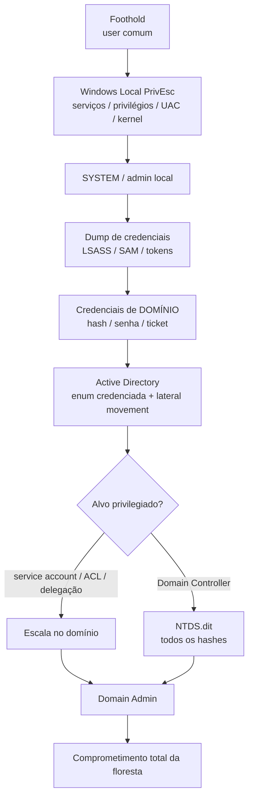

# 🔗 Mapa Mental — Local PrivEsc ↔ Active Directory

> [!info] A ideia central
> Não são dois assuntos separados — são **duas metades do mesmo ataque**.
> **Windows Local PrivEsc = subir dentro de UMA máquina. Active Directory = usar essa máquina pra dominar o DOMÍNIO.**
> O privesc local é quase sempre o **pré-requisito** do ataque de AD: você precisa de SYSTEM/admin num host domain-joined pra extrair as credenciais que abrem o domínio.

---

## 🧭 O fluxo (onde um vira o outro)

> Sem o local, o AD trava (faltam credenciais). Com o local, o AD desaba. E o ciclo **realimenta**: cada credencial nova de domínio abre novos hosts → novo privesc local → mais credenciais.

---

## ⚖️ Diferença de escopo (pra não confundir)

| | **Windows Local PrivEsc** | **Active Directory** |
|---|---|---|
| Alvo | 1 host | domínio / floresta inteira |
| Objetivo | user → **SYSTEM/admin local** | user → **Domain Admin** |
| Técnicas | serviços mal-config, privilégios (Se*), UAC bypass, kernel, DLL hijack, unquoted path | Kerberoast, AS-REP roast, abuso de ACL, DCSync, delegação, NTDS.dit |
| Credenciais-alvo | SAM local, LSASS | NTDS.dit, cached domain creds, tickets Kerberos |
| "Chave" | SeImpersonate, SeBackup, SeTakeOwnership | hash de service account, DA token, machine account |

---

## 🌉 As pontes concretas (privilégio local → impacto no domínio)

| Achado local | Técnica | Vira no AD |
|---|---|---|
| **Conta de serviço logada** (ex. `sccm_svc`, sessão console) | SYSTEM → mimikatz `sekurlsa::logonpasswords` na LSASS | senha/hash da conta → **Pass-the-Hash / lateral movement** |
| **Backup Operators** (`SeBackup`/`SeRestore`) | ignora ACL, copia hives | num **DC** = copiar **`NTDS.dit`** + SYSTEM → **todos os hashes do domínio** |
| **SeImpersonate / SeAssignPrimaryToken** (IIS, MSSQL, service) | Potato family (PrintSpoofer/GodPotato/JuicyPotato) | rouba token → SYSTEM; os tokens em jogo são de contas de **domínio** |
| **SeTakeOwnership** | toma posse de arquivo/config | apropria-se de segredos (chaves, configs) válidos no domínio |
| **Credencial em arquivo** (script, .bak, config) | credential hunting | reuso direto contra outros hosts / o DC |

---

## ♻️ Mesma técnica, ângulos diferentes

- **Kerberoasting** (AD) te dá o hash de uma *service account* → você quebra → usa pra **privesc local** noutra máquina. E uma service account achada no privesc local vira alvo de **Kerberoast** no domínio.
- **SeImpersonate** aparece tanto num IIS/MSSQL **local** quanto numa **conta de serviço de domínio**.
- **Backup Operators** é privesc local numa workstation, mas **comprometimento total** num Domain Controller.
- **Pass-the-Hash**: o hash você pega no privesc local (SAM/LSASS); o alvo você escolhe no AD.

---

## 🗺️ No roadmap CPTS (ordem de estudo)

1. **Windows Privilege Escalation** (este módulo) — virar dono do host.
2. [[Fase 09 - Active Directory]] — enum credenciada → comprometer o domínio.
3. Módulos de ataque: *Active Directory Enumeration & Attacks*, *Attacking Active Directory and NTDS.dit*, *PASS THE HASH*, *PASS THE CERTIFICATE* (pasta **Percalços da Bíblia**).

Relacionado: [[Fase 10 - Privilege Escalation]] · [[Fase 09 - Active Directory]] · [[Fase 11 - Pós-Exploração]] · [[Fase 08 - Pivoting e Tunneling]] · [[Workflow do Engage]]

> [!tip] Regra de ouro
> Ao pisar num host Windows, pergunte sempre as 3 coisas: **(1)** o que EU posso fazer aqui (`whoami /priv /groups`)? **(2)** quem MAIS tem poder e está logado aqui (`query user`, grupos privilegiados)? **(3)** o que esse host alcança (`ipconfig`, domínio, DC)? As respostas decidem se o próximo passo é privesc local ou pulo pro AD.
