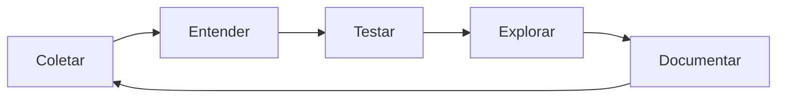

# 🧭 Workflow do Engage — visão ampla

> [!abstract] Como ler esta nota
> Esta é a **parte 1**: o engajamento inteiro, em ordem, com o objetivo de cada fase, o que você produz e quando avança.
> Cada fase tem um link para a nota detalhada (ferramentas, comandos, flags, pegadinhas). Aqui o foco é **decisão e sequência**.

---

## 0. Modelo mental

Um pentest não é "rodar nmap e achar exploit". É um ciclo:

- **Coletar** sem entender gera ruído.
- **Testar** sem escopo gera incidente.
- **Explorar** sem documentar gera retrabalho.
- Toda credencial nova **reabre** a enumeração do zero — com mais privilégio.

Regra prática: **nunca avance de fase sem ter escrito o que sabe e o que falta saber.** O relatório é construído durante o engage.

---

## 1. Pré-engajamento

**Objetivo:** transformar "quero um pentest" em um teste legal, delimitado e seguro.

O que precisa estar fechado **antes** de qualquer pacote:

| Item | Pergunta que responde |
|------|----------------------|
| Escopo | Quais IPs, domínios, aplicações, contas e redes? O que está **fora**? |
| Janela | Quando pode testar? Há horário de silêncio? |
| RoE | Pode phish? Pode DoS? Pode engenharia social? Pode tocar em produção? |
| Contatos | Quem autoriza? Quem é acionado em incidente? |
| Credenciais | Teste black-box, grey-box ou white-box? |
| Entregáveis | Relatório, debrief, reteste? Formato e prazo? |
| Dados | Como tratar PII/loot? Onde armazenar? |
| Emergência | Procedimento de parada e canal de comunicação. |

**Saída:** escopo assinado + notas do engage criadas + lista de alvos normalizada.

> [!warning] Sem autorização escrita não existe pentest. Existe crime.
> Guarde a autorização, o escopo e a janela. Se o cliente pedir algo fora do escopo no meio do teste, **pare e formalize**.

Detalhe: [[Fase 01 - Pré-Engajamento]] · Cheatsheet: [[CPTS 01 - Penetration Testing Process]]

---

## 2. OSINT e reconhecimento externo

**Objetivo:** montar o mapa público da organização antes de tocar no alvo.

O que se busca:

1. **Domínios e subdomínios** — `whois`, `dig`, transferência de zona, Certificate Transparency, `subfinder`, `amass`.
2. **Infraestrutura** — ASN, faixas de IP, provedores, CDN, WAF.
3. **Tecnologia** — `whatweb`, headers, favicon hash, `nmap` de serviços.
4. **Pessoas** — LinkedIn, e-mails, padrão de nomes (`flast`, `first.last`), vazamentos.
5. **Credenciais expostas** — HaveIBeenPwned, DeHashed, GitHub dorks, pastebins.
6. **Conteúdo histórico** — Wayback, `gau`, `waybackurls`, buckets S3 abertos.

**Decisão importante:** OSINT alimenta senhas, usuários e alvos. Um e-mail com padrão claro + política fraca = password spraying mais tarde. Um subdomínio esquecido = superfície não monitorada.

**Saída:** planilha/nota com domínios, IPs, tecnologias, usuários prováveis e hipóteses.

Detalhe: [[Fase 02 - OSINT e Reconhecimento Externo]] · Cheatsheets: [[CPTS 05 - Information Gathering - Web Edition]], [[CPTS 04 - Footprinting]]

---

## 3. Reconhecimento de rede

**Objetivo:** descobrir quais hosts existem e quais portas respondem.

Sequência que funciona:

1. **Descoberta de hosts** — `nmap -sn` na faixa; se ICMP bloqueado, `-Pn` + varredura de portas comuns.
2. **Scan rápido** — top 1000 portas, `-sS`, `--min-rate`, `-oA`.
3. **Scan completo** — `-p-` nos hosts vivos; não confie só no top 1000.
4. **Detecção de serviço** — `-sC -sV` nas portas abertas.
5. **UDP** — top 100 UDP (`-sU --top-ports 100`), especialmente 53, 69, 111, 123, 161, 500.
6. **NSE** — scripts por serviço depois de saber o que roda.

**Decisão:** porta estranha (8080, 8443, 9001, 5985, 1433, 3306) merece atenção; serviço na versão errada/título estranho indica app customizada. Registre **tudo** com `-oA` e horário.

**Saída:** `scans/<ip>/` com `.nmap`, `.xml`, `.gnmap`; tabela host × porta × serviço × versão.

Detalhe: [[Fase 03 - Reconhecimento de Rede]] · Cheatsheet: [[CPTS 03 - Network Enumeration with Nmap]]

---

## 4. Enumeração de serviços

**Objetivo:** transformar "porta aberta" em informação acionável.

Princípio: **enumere até doer**. A maioria dos footholds vem de enumeração, não de exploit zero-day.

| Serviço | O que se procura |
|---------|------------------|
| SMB | shares, null session, usuários, políticas, assinatura |
| FTP | anonymous, arquivos, credenciais em texto |
| SSH | chaves, versão, usuários válidos |
| DNS | zone transfer, subdomínios, PTR |
| SMTP/IMAP/POP3 | usuários válidos, relay, credenciais |
| SNMP | community strings, OIDs, processos |
| SQL | login fraco, `xp_cmdshell`, linked servers |
| RDP | NLA, credenciais, BlueKeep |
| WinRM | credenciais, `evil-winrm` |
| NFS | exports, `no_root_squash` |
| IPMI | hash RAKP, credenciais default |

**Decisão:** cada serviço exposto é uma história. Se o SMB permite listar shares, leia os shares. Se o FTP aceita anonymous, baixe tudo. Se o SNMP responde `public`, leia os OIDs.

**Saída:** por serviço: versão, contas, arquivos, credenciais, hipóteses de ataque.

Detalhe: [[Fase 04 - Enumeração de Serviços]] · Cheatsheets: [[CPTS 04 - Footprinting]], [[CPTS 11 - Attacking Common Services]], [[CPTS 10 - Password Attacks]]

---

## 5. Enumeração web

**Objetivo:** encontrar a funcionalidade escondida e os pontos de entrada da aplicação.

Se houver HTTP/HTTPS, a aplicação costuma ser o caminho mais curto:

1. **Fingerprint** — `whatweb`, headers, `robots.txt`, `sitemap.xml`, erros.
2. **Conteúdo** — `ffuf`/`feroxbuster` com wordlists; extensões por tecnologia.
3. **Vhosts** — `ffuf -H "Host: FUZZ..."`, porque um IP pode servir vários sites.
4. **Parâmetros** — `arjun`, `ffuf` em GET/POST, descobrir `?id=`, `?file=`.
5. **Crawl** — `katana`, `hakrawler`, Burp spider; links e formulários.
6. **Autenticação** — login, registro, reset, cookies, JWT.
7. **Manual** — Burp Repeater; teste cada input com calma.

**Decisão:** todo parâmetro é candidato a SQLi, XSS, SSI, LFI, injeção de comando. Toda upload é candidato a webshell. Todo ID é candidato a IDOR.

**Saída:** mapa de endpoints, parâmetros, contas, tecnologias e hipóteses priorizadas.

Detalhe: [[Fase 05 - Enumeração Web]] · Cheatsheets: [[CPTS 14 - Using Web Proxies]], [[CPTS 15 - Attacking Web Applications with Ffuf]], [[CPTS 05 - Information Gathering - Web Edition]]

---

## 6. Vulnerabilidade e exploração

**Objetivo:** confirmar a falha com evidência mínima e obter acesso.

Fluxo:

1. **Hipótese** — "esse parâmetro parece concatenar SQL".
2. **Teste seguro** — payload que prova sem destruir (`'` e erro, `sleep(5)`, `id`).
3. **Confirmação** — evidência reproduzível.
4. **Exploração** — escolher o caminho de menor risco: credencial default → misconfig → CVE pública → exploit complexo.
5. **Foothold** — shell reversa, webshell, execução de comando.

**Decisão:** exploit público é a **última** opção, não a primeira. Prefira o que não derruba serviço. Se o exploit for instável, documente e teste em horário combinado.

**Saída:** acesso inicial + evidência + comando usado + impacto.

Detalhe: [[Fase 06 - Vulnerabilidade e Exploração]] · Cheatsheets: [[CPTS 06 - Vulnerability Assessment]], [[CPTS 09 - Using the Metasploit Framework]], [[CPTS 24 - Attacking Common Applications]]

---

## 7. Shell e transferência de arquivos

**Objetivo:** estabilizar o acesso e levar ferramentas para o alvo.

1. **Shell reversa** — `nc`, `socat`, PowerShell, msfvenom conforme SO.
2. **Upgrade de TTY** — `python3 -c 'pty.spawn("/bin/bash")'`, `stty raw -echo`, `export TERM=xterm`.
3. **Transferência** — HTTP server no atacante + `curl`/`wget`/`IWR`/`certutil`; SMB server para Windows; `scp`/`base64` quando não há saída.
4. **Ferramentas** — `linpeas`, `winPEAS`, `SharpHound`, `chisel`, `mimikatz` só depois de decidir o próximo passo.

**Decisão:** shell sem TTY limita sudo, su, editores e ssh. Estabilize antes de enumerar privesc.

**Saída:** shell estável + diretório de trabalho (`/tmp`, `C:\Windows\Temp`) + ferramentas transferidas.

Detalhe: [[Fase 07 - Shells e Transferência de Arquivos]] · Cheatsheets: [[CPTS 08 - Shells and Payloads]], [[CPTS 07 - File Transfers]]

---

## 8. Privilege escalation local

**Objetivo:** sair do usuário inicial para root/SYSTEM/Admin local.

**Linux:** `id`, `sudo -l`, SUID/SGID, capabilities, cron, serviços, PATH, NFS, grupos (`docker`, `lxd`, `disk`), credenciais em arquivos, kernel.

**Windows:** `whoami /priv`, grupos, serviços e permissões, caminhos sem aspas, tarefas agendadas, AlwaysInstallElevated, credenciais salvas, UAC, tokens (`SeImpersonate`), patches.

**Decisão:** privesc local não é o fim — é **coleta de credencial**. Ao virar root/SYSTEM, dumpe hashes, chaves e tickets, e reenumere a rede.

**Saída:** novo nível de acesso + credenciais + hosts internos descobertos.

Detalhe: [[Fase 10 - Privilege Escalation]] · Cheatsheets: [[CPTS 25 - Linux Privilege Escalation]], [[CPTS 26 - Windows Privilege Escalation]]

---

## 9. Pivoting e tunneling

**Objetivo:** alcançar o que não é roteável a partir da sua máquina.

Escolha da técnica:

| Cenário | Técnica |
|---------|---------|
| Uma porta específica | `ssh -L` / `socat` |
| Muitas portas, protocolo dinâmico | `ssh -D` + proxychains / chisel SOCKS |
| Sem SSH no alvo | chisel, ligolo-ng, `netsh portproxy` |
| Rede inteira roteada | ligolo-ng / sshuttle |
| Windows sem ferramenta | `plink`, PowerShell, `netsh` |

**Decisão:** cada salto aumenta latência e risco de erro. Prefira **um** túnel SOCKS + proxychains para toda a rede interna, em vez de um forward por porta.

**Saída:** túnel ativo + alcance comprovado (nmap pelo proxy) + novos alvos.

Detalhe: [[Fase 08 - Pivoting e Tunneling]] · Cheatsheet: [[CPTS 12 - Pivoting, Tunneling, and Port Forwarding]]

---

## 10. Active Directory

**Objetivo:** sair de um host qualquer para controle do domínio.

Ordem que evita retrabalho:

1. **Contexto** — domínio, DC, usuário atual, grupos, trusts.
2. **Enumeração sem credencial** — usuários (kerbrute), SMB null, LDAP anônimo, AS-REP.
3. **Com credencial** — PowerView/BloodHound/`nxc`; mapear ACLs, sessões, GPOs, SPNs.
4. **Coleta de credencial** — Kerberoasting, AS-REP roasting, Responder, `secretsdump`, LAPS, GPP.
5. **Abuso de caminho** — ACL (GenericAll, WriteDACL, ForceChangePassword), RBCD, unconstrained delegation, ADCS, trusts.
6. **Compromisso** — DCSync, `psexec`/`wmiexec` no DC, golden ticket, ExtraSids.

**Decisão:** BloodHound mostra o caminho mais curto. Não ataque no escuro. Cada aresta tem pré-requisito e detecção — escolha a menos ruidosa compatível com o escopo.

**Saída:** caminho documentado até Domain Admin + hashes/tickets + evidências.

Detalhe: [[Fase 09 - Active Directory]] · Cheatsheet: [[CPTS 13 - Active Directory Enumeration and Attacks]]

---

## 11. Pós-exploração

**Objetivo:** provar **impacto** e responder "até onde dá para ir".

- Coletar: credenciais, hashes, tickets, chaves SSH, configs, bancos, shares.
- Mapear: trusts, redes, backups, sistemas críticos, dados sensíveis.
- Movimento lateral: mesmas credenciais em outros hosts (password reuse).
- Persistência: **somente** se autorizada. Caso contrário, não.
- Limpeza: remover ferramentas, shells, contas e arquivos criados; registrar o que ficou.

**Decisão:** pare quando o objetivo do escopo for provado. Ir além aumenta risco sem entregar valor.

Detalhe: [[Fase 11 - Pós-Exploração]]

---

## 12. Relatório e encerramento

**Objetivo:** transformar o caos em decisão de negócio.

Estrutura mínima:

1. Capa e classificação de confidencialidade.
2. Sumário executivo (para quem não é técnico).
3. Escopo e metodologia.
4. Sumário de achados (tabela com severidade).
5. Achados detalhados: descrição, evidência, impacto, CVSS, remediação.
6. Cadeia de ataque (como os achados se conectam).
7. Apêndices: ferramentas, comandos, saídas, timestamps.
8. Reteste e encerramento.

**Decisão:** achado sem impacto de negócio é ruído. Escreva o "e daí?".

Detalhe: [[Fase 12 - Relatório e Encerramento]] · Cheatsheet: [[CPTS 27 - Documentation and Reporting]]

---

## 🧠 Regras que valem o engage inteiro

1. **Escopo é lei.** Na dúvida, pergunte antes.
2. **Documente enquanto faz.** Comando copiado depois é comando inventado.
3. **Evidência > opinião.** Screenshot, saída, timestamp.
4. **Menor privilégio e menor ruído** compatíveis com o objetivo.
5. **Não derrube produção para provar ponto.**
6. **Credencial nova = reenumeração.** Sempre.
7. **Exploit público é hipótese, não verdade.** Leia o código.
8. **Relatório é o produto.** O resto é meio.
9. **Limpe o que criou** e registre o que não conseguiu remover.
10. **Pare e comunique** se algo sair do previsto.
